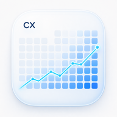
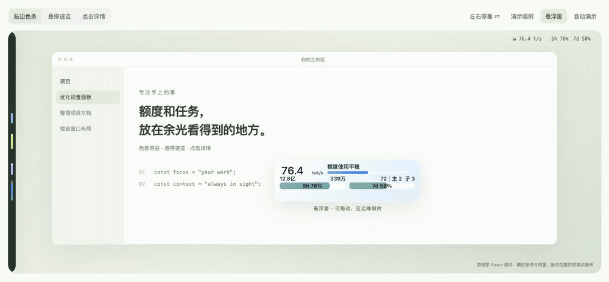
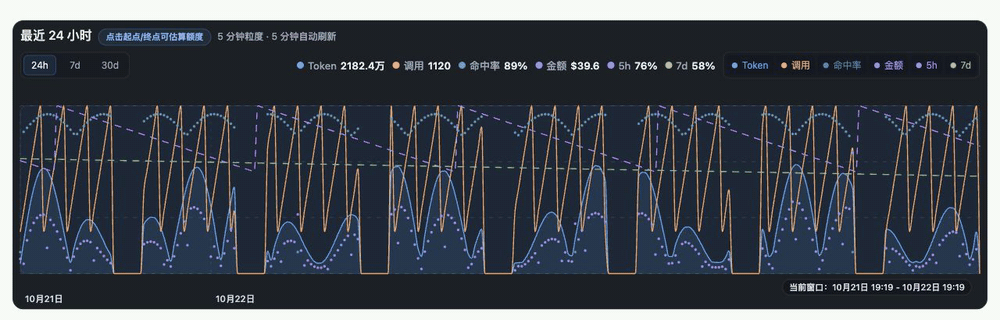
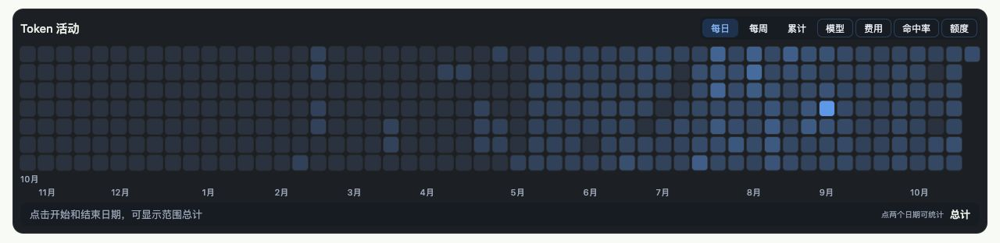
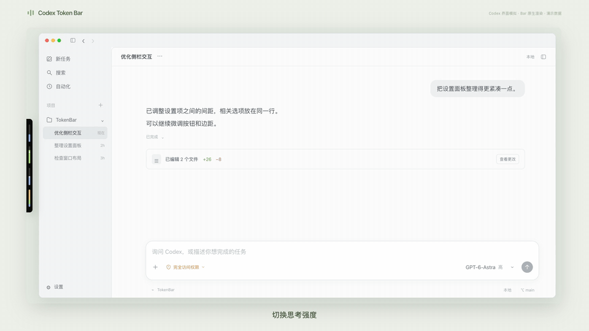
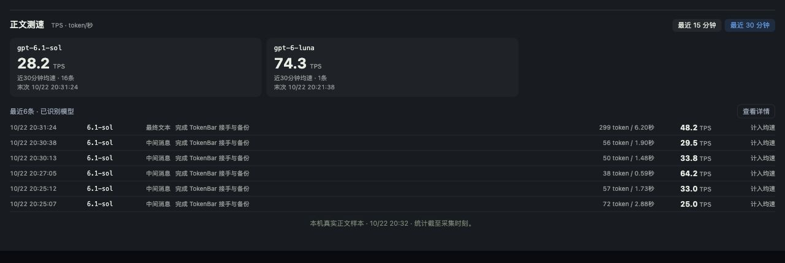

<p align="center"></p>
<h1 align="center">Codex Token Bar</h1>
<p align="center"><b>专注写代码。额度和进度，一眼有数。</b></p>
<p align="center">多种显示方式 · 官方额度 · 缓存提醒 · 用量趋势 · 模型 TPS</p>
<p align="center">简体中文 · <a href="README.en.md">English</a></p>
<p align="center"><a href="https://github.com/hututuo/codex-token-bar/releases/latest">下载最新版</a> · <a href="#安装">安装说明</a> · <a href="#完整工作台">完整功能</a> · <a href="docs/DEVELOPMENT.md">开发与打包</a></p>

Codex 在干活，额度还剩多少、哪几个任务在跑、缓存有没有命中、模型输出有多快？**Token Bar 把这些信息放在余光里，需要时再展开。**

macOS 使用 Swift / SwiftUI 原生实现；Windows 提供 Tauri + React + Rust 的 x64 / ARM64 版本。用量与正文统计在本地处理，支持多个会话并行使用。

## 多客户端，本地统计

默认保持 Codex 视图；检测到 Claude CLI、Claude Desktop 等已支持客户端后，可主动启用，在单客户端与汇总范围间切换。Claude 只读取本地会话及已有额度缓存，不发起 Anthropic 网络请求；没有本地额度缓存时不会显示虚构额度。Codex 官方额度功能仍需要本机已登录的 Codex。

速蹬排行榜上报是独立选项，默认关闭，可随时关闭；仅上传允许来源的速度、Token、模型及 Harness 等统计，不上传对话或账号凭据，Claude 来源不参与上报。两个本地业务数据库保留已有 Codex 账本与新客户端/测速记录；升级有备份，删除原始会话不会抹除已入账历史。

## 不用切回主窗口，也知道发生了什么

**侧边栏、悬浮窗、菜单栏／托盘、主界面，选你顺手的显示方式。** 官方额度监控直接融入这些显示面，无需反复打开账号页面。

<p align="center"></p>

| 显示方式 | 怎么用 |
|---|---|
| 贴边侧栏 | 左右停靠、自动吸附、记住位置；平时是一条色条，悬停查看概要，点击查看完整详情。 |
| 桌面悬浮窗 | 把速率、用量、任务、模型占比和额度放在桌面一角；可拖动，调整内容、顺序、配色、字号和透明度。 |
| 菜单栏／托盘 | 主窗口收起后仍有状态入口，随时返回仪表盘；具体外观和可配置项随平台而异。 |
| 主界面 | 用量、额度、图表、缓存排行、模型速度和会话管理集中查看。 |

**官方额度与使用节奏一起看：**按账号实际提供的窗口显示 5h／7d 剩余和重置时间；接口提供 Reserve 时单独展示。额度条上的白线是均匀使用参考，帮助判断当前消耗节奏。重置卡可查看接口提供的数量、来源和到期信息，仅展示，不自动兑换。

## 额度花在哪，沿着时间线看清楚

**刚才用了多少？今天哪段最密集？选一段时间，对照本地用量与额度变化。**

<p align="center"></p>

- **24 小时 / 7 天 / 30 天趋势**：24 小时按 5 分钟分桶；切换 token、调用、缓存命中率、API 等值费用和额度曲线。
- **悬停、横向浏览、区间汇总**：回看某段工作的用量、模型构成和额度变化；按同周期数据反推额度容量，作为使用参考。
- **365 天活动热力图**：查看每日、每周、累计、模型占比、模型费用、缓存命中和额度剩余；点击两个日期汇总区间。
- **按模型和 token 构成拆开看**：输入、缓存输入、输出分别统计，缓存包含在输入中。

<p align="center"></p>

官方剩余额度、使用节奏参考和 API 等值费用分别标示。**API 等值是按已知模型价格计算的参考值，不是订阅实际扣费**；缺少价格时会显示已知小计或待读取。

## 额度突然跑得快？先看这次缓存

换了模型、思考强度或上下文后，如果本次请求缓存复用偏低，**侧栏会主动提醒，显示命中率和相关会话。** 看一眼，再决定是否检查刚才的操作。

<p align="center"></p>
<p align="center"><a href="Assets/showcase/cache-reminder.mp4">播放有音效的完整演示（12 秒）</a></p>

提醒可关闭；新上下文首次请求豁免。按实际返回的 token 用量判断，**不按等待时间判断缓存失效**。模型、强度或上下文变化只是可能的排查方向，低命中本身不能确定原因。

主界面还可按会话或单轮查看缓存排行、命中与未命中 token，搜索、筛选并追到具体上下文。

## 现在在忙什么，哪个模型输出更快

**实时活动曲线看进度，正文 TPS 比较模型。** 侧栏显示近 30 分钟内各模型最新合格读数，详情补充近 15 / 30 分钟均速。

<p align="center"></p>

| 指标 | 它告诉你什么 |
|---|---|
| 实时活动速率 | 汇总多个会话的本地活动估算，展示工作节奏；识别到中断时停止，正常完成后最多收尾 5 秒。 |
| 正文 TPS | 已完成助手正文的本地分词量 ÷ 日志起止时长，包含中间消息和最终文本。展示最新读数、模型均速与可追溯样本。 |

主界面显示最近 6 条；查看详情可定位**采样时间、会话、轮次、正文 ID、正文类型、token 数、时长、TPS 和置信度**。短计时、计时不一致和异常速率等样本保留原因，不参与模型均速。

正文 TPS 可能包含网络等待，不能当作服务器纯生成速度；隐藏思考和工具返回不作为正文测速样本。实时曲线也不作为实测速度记录。

## 完整工作台

| 还可以做什么 | 功能 |
|---|---|
| 查看并行工作 | 主会话与子 Agent、模型和思考强度；任务完成和未读反馈。 |
| 追踪历史账本 | 已入账的用量在会话归档、移动、删除后保留；fork 后新增轮次继续统计，压缩／未压缩来源避免重复记账。 |
| 查看参考信息 | 官方 Radar 的建议和趋势、社区 RadarBench 的排行与覆盖情况；第三方数据标明来源和状态。 |
| 管理会话 | 搜索、归档、恢复归档；创建、校验、导出恢复包；永久删除前核对影响范围并备份。 |
| 改善会话体验 | Markdown 导出、项目移动、ID 显示、粘贴修复、阅读宽度和滚动位置恢复等可选增强。 |
| 管理独立实例 | 创建或登记独立 Codex Home 与桌面数据目录；启动、停止、配置与会话同步，分歧保留和校验回滚。 |
| 配置自动续跑 | 指定精确会话，按间隔、每日时间、额度恢复或特定失败条件续跑，设置冷却和每日次数限制。默认关闭。 |
| 自定义桌面 | 浮窗内容、排序、配色、字号、透明度、完成提示，以及显示面开关。 |

自动续跑的“自动批准普通操作”为独立选项，默认关闭；危险操作、额外权限、人工输入和未知请求仍拦截。旧 Codex 侧栏直接删除入口已停用，删除请使用 Token Bar 的会话管理流程。

**交互展示页：**仓库同时提供 [完整展示页源码](docs/showcase/index.html)。本地运行 `python3 -m http.server 8080` 后打开 `http://127.0.0.1:8080/docs/showcase/`，可直接操作原程序组件，包括侧栏展开、左右停靠、完整详情、悬浮窗分页、图表图例和时间范围。

上方显示方式、用量图和正文 TPS 使用作者授权公开的本机真实统计快照，采集时间见画面，不是实时监控或模型性能基准。界面使用跨平台原组件与原样式；缓存宣传片单独使用模拟情境，Bar 提醒为原生渲染。素材来源与重建方法见 [展示制作说明](docs/showcase/README.md)。

## 安装

从 [GitHub Releases](https://github.com/hututuo/codex-token-bar/releases/latest) 下载对应平台安装包和同版本 `SHA256SUMS`。

| 平台 | 安装包 | 要求 |
|---|---|---|
| macOS Apple Silicon | `CodexTokenBar-v0.9.8-macos-arm64.dmg` | macOS 14+；打开 DMG，拖到 Applications。 |
| Windows x64 | `CodexTokenBar-v0.9.8-windows-x64-setup.exe` | Intel / AMD Windows 10/11。 |
| Windows ARM64 | `CodexTokenBar-v0.9.8-windows-arm64-setup.exe` | Windows on ARM，应用二进制为 ARM64。 |

可选校验：

```bash
# macOS：与同版本 SHA256SUMS 中的值比较
shasum -a 256 CodexTokenBar-v0.9.8-macos-arm64.dmg
```

```powershell
# Windows：与同版本 SHA256SUMS 中的值比较
Get-FileHash .\CodexTokenBar-v0.9.8-windows-x64-setup.exe -Algorithm SHA256
```

macOS 目前为 ad-hoc 签名，尚未公证。首次打开如提示未知开发者，可在“系统设置 → 隐私与安全”中确认“仍要打开”。Windows 暂无商业代码签名，SmartScreen 可能提示未知发布者；请从本仓库 Release 下载。缺少 WebView2 Runtime 时，安装器按默认策略处理。

macOS 也可用以下命令安装最新版并替换已有应用：

```bash
curl -fsSL https://raw.githubusercontent.com/hututuo/codex-token-bar/main/install.sh | bash
```

macOS 使用 Sparkle，Windows 使用独立的 Tauri 更新通道；默认每 4 小时检查，确认后安装。更新失败时可下载同架构安装包覆盖安装，保留本地历史数据。

## 数据与常见问题

- **数据从哪来？** 本机 Codex Home 中的 `sessions/` 提供用量和轮次，SQLite 元数据补充会话信息；Token Bar 保留自己的本地统计索引。额度与重置卡通过本机官方 Codex app-server 读取，由 Codex 处理网络与鉴权。
- **会上传对话吗？** 应用不上传 prompt、输出、会话日志或账号额度。额度查询和第三方雷达需要联网；雷达参考与本地统计分开标示。
- **为什么没有 5h / Reserve？** 只展示账号接口实际返回的窗口，不补造额度。
- **额度读不到怎么办？** 先确认 Codex 已登录且可正常访问账号。使用应用中的诊断信息反馈具体版本、平台和报错。
- **删除会话会删掉统计吗？** 已入账的历史统计保留；从未被读取、且源文件已经丢失的用量无法凭空恢复。
- **还有续问时限建议吗？** 该建议、缓存间隔图和额外扫描仍隔离停用；缓存统计、提醒与费用账本保留。[历史设计](docs/design/cache-retention-dynamic-p95-drop.md)仅供查阅。

开发、双端打包、更新签名和可选 Codex 侧栏补丁见 [开发与维护](docs/DEVELOPMENT.md)。

## 交流与反馈

安装或使用遇到问题，可在 [Issues](https://github.com/hututuo/codex-token-bar/issues) 提交系统版本、软件版本、报错和截图，也欢迎扫码进群。

<p align="center"><br><sub>二维码有有效期，失效时请通过 Issue 反馈。</sub></p>

## License

GNU AGPL v3。保留原 Codex Token Bar 的 [MIT 声明](LICENSES/CodexTokenBar-MIT.txt)，Codex++ 的归属和修改说明见 [OPEN_SOURCE_NOTICES.md](OPEN_SOURCE_NOTICES.md)。
