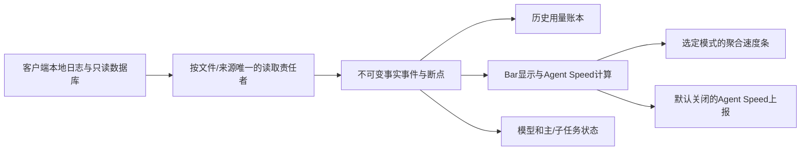

# 多客户端、聚合速度与两库统一方案

2026-10-27，设计定稿 v20。适用 `codex/multi-client-tokens`，基线提交 `327b12b1`。本页记录确定的目标与实施顺序，不表示功能已经实现。只更新文档；不替换应用、不动 Windows EXE、不请求 Anthropic。

2026-10-28 实施状态：[旧库归并与共享读取回执](../../maintenance/2026-10-28-business-ledger-and-shared-io.md)。A 已改共同容器内的版本化模块分区；Swift/Rust 旧模块 DDL 保留各自 schema，不作同表直接互读。物理 transcript 读取统一，解析/游标保持独立；外部 SQLite 继续只读原生查询。历史阶段回执中的“未完成”是当时状态，以本次回执为准。正式库未迁移、正式应用未替换。

## 1. 本次确定的决策

| 项目 | 定稿 |
|---|---|
| 主体与风格 | Codex 默认视图；沿用原模块、侧栏、圆环与色条，不另造客户端大卡 |
| 来源范围 | 一个全局范围选择，控制整页与侧栏的来源；切换范围不启停来源采集 |
| 聚合速度 | 选定来源、同一显示模式下的活动输出速率相加，模型颜色分段 |
| 显示算法 | 全局 `Bar 模式（默认） / Agent Speed 模式`；持久保存，Mac/Windows 同协议 |
| 排行榜 | 固定 Agent Speed 标准，与显示选择无关；主动开启、默认关闭 |
| Claude | 本地 usage/额度/任务/活动速度；不再独立提供正文 TPS 或 API 耗时 TPS 页面 |
| Codex 正文 TPS | 保留已有采样、资格规则、最新与5/15/30滚动均值和趋势，不塞进聚合活动速度 |
| 读取器 | 一份物理日志一个增量读取责任者；复用读取、事件分发，消费者分别计算 |
| 数据库 | 最多两个长期可写业务 SQLite：A 原 Codex 业务库，B 多客户端业务库。不能按模块再开库 |
| Windows | 同 schema、身份/去重/聚合规则、设置和验收用例；只允许平台适配不同 |
| 原始记录 | 不删除已入账用量；归档、移动、源文件丢失不删除索引；fork新增轮次保留 |
| Claude 网络 | 本地采集/显示路径无 Anthropic 请求、无凭据读取、无 Claude 子进程、无配置自动改写；仍禁止上报 |

“两个数据库”指本应用长期使用的可写业务库。Codex 的 state/log SQLite、OpenCode 原数据库等属于只读外部数据源，不是 Bar 自建库；不能修改/删除。SQLite 的 WAL/SHM 是同库配套文件。只读升级备份可以有多份，不得以减少库数量为由删备份、删旧账。迁移过程读取旧库不算继续启用旧写入器。

## 2. 模型归属：上游已有，产品映射补齐

Agent Speed 原版已有模型字段：Claude message.model、解析后的 ResponseRecord.model、AgentStatus.model，Codex 路径亦有模型归属。不是重新做模型指纹识别，不向模型发额外请求，也不证明代理实际服务了哪个底层模型。

产品补齐以下链路：

1. 保留 `client + source/root identity + session + turn/request/item identity + event time + raw model`；上游没有的精确身份不得从当前选中会话猜补。
2. 对明确别名生成 canonical model key；原始 model 字符串不改写，未知版本不随意并入已知型号。
3. 速度先按客户端/会话/模型保留贡献，再在显示阶段将相同 canonical model 的并发活动速率相加。
4. 模型切换按事件时刻归属，不能用会话最新 model 回填早先响应；同时核对上游 AgentStatus 当前模型聚合是否丢失上一模型尾部贡献，缺口由事件归属适配补齐。
5. 不知道型号的贡献保留在“未知模型”灰色段，不能丢掉，也不能填成最近出现的模型。总速度必须等于所有可用色段之和；已知/未知来源覆盖可在详情查看。
6. 统一模型注册表为全软件提供名称、颜色、别名：Astra 绿、6.1 Sol 橙红、6 Luna 蓝，Claude 等各型号用同一注册表的稳定映射。客户端品牌色用于额度标记，不替代模型色。
7. 同模型出现在多个客户端时总条可合色，但详情能拆来源；多客户端不是复制同一会话并算两遍。

目前 ClaudeLocalRuntime 已把上游 agent.model 与 agent.live.output 投影成模型贡献；还需补未知模型保留、切模尾部与跨模式一致性测试。本页不把已有投影视为全部完成。

## 3. 聚合速度与显示选择

### 3.1 Bar 模式（默认）

- Codex 使用现有 Bar 曲线：观测输出/思考信号、暂估与结算校准、现有平滑、取消/失败清零、网络故障暂停、新输出恢复、结束最多5秒收尾。
- Claude 等使用 Agent Speed 的本地活动速度，不编造一套没有数据依据的正文起止时间。
- 两者都是活动估算，允许合成“聚合活动速度”，不能把它命名为统一精确正文 TPS。其统计方法标签必须保留到明细。
- 不再给 Bar 曲线和 Agent Speed 曲线各摆一条同含义总速度条。默认只展示一条，原模型色段组件复用。

### 3.2 Agent Speed 模式

- 选定来源中已支持的客户端，统一取同一 pin 的上游活动速度组成总条。
- 上游未支持的来源标注不支持，不回退混入 Bar 值后仍称“统一 Agent Speed”。
- 切模式按新数据版本替换贡献，不复用旧模式的预算或尾迹；短暂插值仅限显示，不改变样本/用量。
- 对有可靠本地中断证据的来源，显示层通用停止守卫可以立即停条；不改写上游上报统计，不把未知网络状态当作已断网。

### 3.3 聚合与刷新规则

- `总活动速度 = Σ 本次允许显示的有效模型贡献`；一个来源/会话同一时刻只选一套贡献。
- 相同单位使用 output tokens/s，不混入 input+output 的 total rate，也不把正文 TPS 均值叠加进去。
- 来源无数据时是“未接入/不可用”，可靠空闲是0；不能把不可用默认补0后声称全来源总和。
- 快照包含 source scope、display mode、generation、timestamp 与 method；范围或模式切换时不跨代混色/借旧读数。
- 复用原刷新和动画节奏，静止时无持续动画；数据更新在后台，主线程只消费有限快照。
- 侧栏设置仅增加一组选项，放在速度模块设置；不为每个模型、每个菜单层级新增算法开关。

### 3.4 均速和趋势

- 活动速度均值按 `Σ(rate × covered seconds) / Σ(covered seconds)`；无覆盖不伪造速度。保存 covered seconds/active seconds，可区分无样本和可靠空闲。
- Codex 正文 TPS 仍按 `Σ有效正文 tokens / Σ有效正文 duration`；和活动均速完全分开。
- 当前活动、最新速度、5/15/30分钟、近半小时趋势统一位置和标签，近半小时每5分钟一桶。
- 历史按 `display_mode + estimator_id/version + metric_kind + client + model` 分开。Bar模式下Codex/Claude可以组成带来源标签的聚合活动曲线，但原贡献必须可拆，不把各自方法混成一项精确测速样本；不能在一个5分钟桶里混算显示模式切换前后的两套值。切换显示不改过去记录。
- 用量24h/7d/30d沿用原5分钟/1小时/6小时图表；速度以5分钟基础桶产生可加权上卷，不能平均几个平均数。

## 4. Claude TPS 的收敛

已核对 Agent Speed、Claude HUD、cc-speed 与官方 Agent SDK。现有被动本地会话记录不足以普遍复原类似 Codex 的正文首尾时刻。SDK流式事件属于其自己启动/管理的 CLI 进程输出，不是对任意既有交互会话的被动附着；本方案不引入包装启动器、代理或额外推理请求。

决定：

- 取消 Claude 独立正文/API TPS 页面、二级/三级菜单入口与持续采样作业；Claude 的活动速度、近期值和趋势统一放进“速度”。
- 来源为 Claude-only 时不展示空的 Codex 正文 TPS 模块；汇总时正文 TPS 明确标“Codex 正文”，不混 Claude。
- Claude statusline 继续只负责本地额度、上下文等；取消测速不影响额度可用性。
- 已写入的 claude-local-speed.sqlite 不删除。停止写入后只读迁入 B 的 legacy speed 表，保留方法版本与低可信标记，不作为新活动速度样本、不混入均值。
- Claude 本地 statusline 无数据的用户显示未接入；有数据的按现有过期规则显示，不强迫所有用户设置。

来源：
- [Agent Speed](https://github.com/zoefix/agent-speed/tree/a94a67fcc78e5d8eea5f82d8d5e737bccf994e2c)
- [Claude HUD 本地请求耗时测速](https://github.com/jarrodwatts/claude-hud/blob/cf95a322afd18db045175d28962650ae7392ed77/src/speed.ts)
- [cc-speed 时间差口径](https://github.com/bryant24hao/cc-speed#how-it-works)
- [官方 SDK 子进程流式输出](https://github.com/anthropics/claude-agent-sdk-python/blob/main/src/claude_agent_sdk/_internal/transport/subprocess_cli.py)

## 5. 单次读取与复用边界

目标数据流：

- 用 canonical source identity 注册文件所有权：同一物理日志不可被实时、账本、上报三方各自 seek/read。文件系统通知只做触发，不当作事件产生时间。
- 历史扫描低优先级，实时新增优先；单文件历史补读与尾读共享游标/区间调度，不能争用偏移或饿死实时更新。
- 第一阶段统一 IO 和不可变批次；不同消费者所需字段保留各自解析适配，不能为了“一次解析”丢掉原账本未知字段、缓存类别和稳定ID。随后把等价字段解析收口，不能虚称读一次就已经完全解析一次。
- 上游公开快照不含所有精确请求ID/字段存在性，因此不能单靠 SpeedSnapshot 重建详细账本。保留原始字段存在位，未知不能在归一化后变成0。
- 在 vendored reader 边界增加最小批次/事件出口，Token Bar在vendor外做分发。若需要改上游非公开入口，记录成新增本地补丁，更新UPSTREAM锁、MIT说明和同步文档，不另复制一套上游核心。
- 持久游标与对应已入账事实在各所属库同一事务提交；跨A/B不假装一个事务。采用来源事件序号、消费者水位和幂等键实现至少一次投递/重复抑制；启动可补齐未确认消费，源文件已丢失时仍保留已提交事实。
- 队列和单批读取有上限，溢出时保留断点继续读，不静默扔掉Token。仅内存活动画面可以过期，不删除历史账。
- Windows长期 helper 与Rust后端通过受控本地管道交换白名单事实；helper不开第二套历史数据库、不重复启动/停止。报告端消费同一上游计算结果，不再独立启动同来源扫描器。

## 6. 两个数据库：现状、目标与迁移

### 6.1 升级前盘点（历史基线）

源码能构造的旧业务库包括：按CodexHome区分的exact索引、quota-history、body-speed、shared-account-usage-safety、modeltrace；本分支还增加multi-client-usage与claude-local-speed。exact索引还存在staging/candidate恢复库。并非每台用户机器都同时有这些文件，但不能称为现在已经只有两个。

Agent Speed HistoryService 虽在vendor里有history.sqlite路径，Token Bar生产调用链没有启用它。上报队列/报文目前在内存，helper不创建上报SQLite。不要误算为已经启用了第三方历史库，也不要为了接功能再启用它。

### 6.2 目标分工

| 业务 | A：Codex 原业务库 | B：多客户端业务库 |
|---|---|---|
| Codex exact事实、账本、fork与会话索引 | 保留、迁移不重算替代 | 不复制同一份原账 |
| Codex额度观测、周期和账本投影 | 迁入原quota-history数据 | — |
| Codex正文测速明细/趋势 | 迁入body-speed数据 | — |
| 原共享账户安全观测/协调 | 迁入并保留原耐久与互斥保证 | — |
| 原ModelTrace历史 | 迁入 | — |
| Claude/DSH/Gemini/OpenCode用量 | — | 原multi-client账本继续使用 |
| 多客户端发现、事件修订、来源断点 | Codex自身索引断点 | 新客户端断点、消费者水位 |
| Agent Speed与聚合活动速度历史 | 不再另开活动库 | 方法分离的明细与5分钟聚合，Codex来源标识保留 |
| 废弃的Claude API测速历史 | — | legacy表，隔离、不用于新均速 |
| 上报队列 | — | 当前内存队列保持；未来若需耐久化，只能加B表，不另开库 |

A以稳定 `codex-ledger.sqlite` 容器保留登记的全部旧Codex账本分区，固定应用业务库路径，不再因切换CodexHome新建一堆库；各来源通过source identity隔离。新安装可使用稳定名 `codex-ledger.sqlite`。B继续使用 `multi-client-usage.sqlite`。升级不可仅改文件名就认为完成合并。

若旧机器存在多个CodexHome索引，各旧库身份与行号保留在迁移映射中，避免不同库相同UUID/整数ID碰撞；不能只取一个库、不能依靠仍存在的原JSONL重新扫一遍替代迁移。复杂原索引/恢复规则必须专项回归后才切换路径。

旧staging/candidate长期工作库改为A内按job隔离的staging表；事务恢复不再常态启动第三份SQLite。只读备份及迁移输入保留。SQLite临时文件/WAL不是第三份业务账本，但不得用“缓存”名义继续写独立业务库。

### 6.3 B库表与索引职责（逻辑名，DDL实施时统一）

| 表族 | 保留范围 | 核心索引/约束 |
|---|---|---|
| client_usage_events / revisions | 已入账事实长期保留，修订有依据 | 唯一来源事件身份；client+time；client+model+time；session+request |
| client_sources / file_checkpoints | 持久、支持迁移/移动别名 | canonical source key、representation映射、游标及generation |
| speed_samples | 活动明细7天 | method/version+time；client+model+time；唯一sample ID |
| speed_buckets_5m | 30天，保留可加权量 | bucket+display_mode+estimator/version+metric_kind+client+model唯一键；总量/耗时/覆盖秒数/样本数 |
| client_quota_observations | 仅确有本地观测；不创建另库 | provider+已知account scope+window+time；未绑定账号不可伪造身份 |
| consumer_watermarks / migration_log | 持久 | consumer+source唯一；版本、校验、完成状态 |
| legacy_claude_speed | 导入原数据，不用于新统计 | legacy identity唯一；保留原method与可信度 |

A保留原关键索引/外键/事实语义，增加按来源隔离与迁移映射；不先统一成上游日聚合。索引以真实查询验证EXPLAIN，不给每个字段盲目加索引。

### 6.4 升级与回滚

1. 枚举本应用旧库与活跃写入者，获得跨进程迁移锁；预览使用独立根目录，不操作正式库。
2. 通过SQLite备份API取得一致备份，校验可读性、完整性与空间；不能只复制正在写入的主文件而漏WAL。空间不足保持旧版读取，不删账本换空间。
3. 导入A/B的隔离staging表，保留旧store identity、原行ID、事件时间、token类别、source-root、账户/周期和revision。不能仅核总Token而遗漏费用、缓存或fork新增轮次。
4. 对账：逐表数量/主键集合/规范化行哈希、来源与模型分组Token、缓存/费用/周期、归档/删除/fork样本；检查外键、quick_check/integrity_check。
5. 在各目标库事务中提交迁移状态，完成后原子更新应用DatabaseLocator；跨库不声称原子提交，通过阶段清单与可恢复journal处理一半完成时的重启。
6. 停用所有旧写入器；旧库只读备份，不双写、不自动删除。任何失败保留原路径/断点和可回退版本；不得发布半份索引。
7. 验证稳定状态仅A/B两个业务写入库（含模块按需打开时）；打开额度、ModelTrace、TPS等页面也不能创建第三库。

A内共享账户安全记录保留原FULL同步/互斥/故障关闭语义，不能因归并为统计库而降低耐久级别。写入使用每库串行owner，后台事务批处理；UI只读有限快照，锁等待不阻塞主线程。A与B独立schema版本和模块迁移登记；Mac/Windows最终共享各自目标库的DDL与迁移规范，不允许同一user_version对应不同DDL。实施采用同一容器 DDL、不同版本化模块命名空间：Swift/Rust 原索引通过对象绑定接入，保留原模块 DDL/行身份与数值。容器版本与每模块版本独立，禁止同一模块版本对应不同 DDL；不宣称平台旧模块可以直接同表互读。具体证明、备份与恢复见本次回执。

### 6.5 容量与保留

- 活动速度不按每帧落库。明细按事件/有意义的速率采样保存，历史曲线用5分钟累加桶；最新动画只在内存。
- 活动明细7天，活动聚合30天；Token事实索引、已有费用账本不随测速TTL清理。旧Claude测速导入保留原数据，不因此新建永久采样作业。
- 容量在实施时用真实合成/公开fixture测量SQLite页、索引和WAL，而不是只算JSON文本。粗预算若每条含索引0.5–1.5KB，每天1万条，7天约35–105MB；这是测量前预算，不是本机实测。
- 同一业务库的历史Token仍会增长，不承诺全库恒定大小。空闲时有界清理速度过期行/检查点，不频繁全库VACUUM、压缩或反复扫旧压缩日志测速。

## 7. Windows统一决策

| 项目 | 双端最终规则 | 当前源码状态（运行验收另列） |
|---|---|---|
| Agent Speed版本 | Swift/C#同pin、同spec、同上游测试向量 | 已有pin锁；更新继续同步 |
| 显示模式 | 相同全局枚举/默认值/持久化；独立于上报开关 | 已接，两种算法不重复叠加 Codex |
| 模型贡献 | 相同canonical ID、未知段、配色、切模/并发归属 | 已接，按事件模型归属，shared fixture 覆盖 |
| 文件读取 | 共享定位读取；helper持久化、本地管道 | 已接有界物理缓存/管道；独立游标/解析保留，SQLite 原生只读例外 |
| 事件完成采样 | 有序事件批次、稳定ID和消费水位 | 不能只轮询latestResponse，短时多条会漏 |
| 数据库 | 同两库分工、容器DDL、版本规则、迁移与TTL | A 模块分区归并，B 已统一；原平台模块 DDL 显式分开，Claude API库路线退役 |
| 速度趋势 | 同method/version与5分钟统计公式 | 已持久 B，7天明细/30天桶 |
| Codex正文TPS | 保留原功能；同资格阈值、模型归属、加权公式、保留设置 | 继续用同fixture验证 |
| Claude正文/API TPS | 两端都不新增独立入口 | Mac现有页面/作业停用，Windows不再补此路线 |
| 价格 | 统一当前价资源、冻结历史；未知保留未知 | 当前价及历史数据已共用，Swift/Rust计算用向量约束 |
| Claude额度 | raw statusline本地采集、同白名单/过期规则 | .NET 编译及离线自测已通过；真实 Windows 采集仍 NOT_RUN |
| 安全/上报 | Claude无网络采集、禁上报；主动开启其他上报 | 原防护不能在统一扫描时被绕开 |
| 打包/安装 | 本分支不替换Windows EXE或正式Mac | 需要安装验收时按原授权边界另行处理 |

“统一”指行为、数据协议、算法规范和验收结果一致；Swift/Rust/C#适配层不要求强行变成同一语言。不得分别修改公式、阈值、时间边界与DDL。共享golden fixtures由两端运行、核对相同输出。Windows SQL聚合不能在前端用有限明细列表平均来冒充全量数据库均值。

Mac原生与Mac上的Tauri候选若并存，不能把两个当前目录简单指到同一SQLite就让不同schema/写入锁混用；候选保持独立根，正式迁移后只有指定backend持有writer lease。

## 8. 上报与同步维护

- 默认关闭、用户主动参加，可随时关闭；来源允许集合与显示范围/模式分开，不能切个显示模式就扩大采集/上报范围。
- 同一读取服务可供显示和上报消费，但消费者有各自授权过滤；Claude Code/Desktop事实在排队、签名前、发送前仍拒绝上报，不因共用读取器进入包体。
- 只上传现有白名单速度/Token/模型/Harness等统计；不上传正文、工具内容、账号凭据或本地路径。注册与设备签名密钥继续走原设备安全存储，不塞进新SQLite。
- 保留现有HTTP默认/可选WebSocket和协议签名/ACK规则；本方案不改变后台协议或宣称联调完成。
- 修改vendor入口、字段或来源适配必须同步 [上游维护文档](../../maintenance/agent-speed-upstream-sync.md)、UPSTREAM锁、补丁原因、Swift/C#/spec/tests。只复用上游能力，不启用额外HistoryService数据库或价格下载。

## 9. 实施顺序与验收

1. 先固定跨平台事件、模型身份、显示模式、两库schema/迁移manifest及golden fixtures；不先发布一个只有Mac的新schema。
2. 实现读取broker/最小vendor出口，先证明Token/归属/断点与原扫描等价；保留原账本对账，不重放网络请求。
3. 实现两库迁移与旧writer退役，覆盖多CodexHome、peer历史、断电中断、WAL、锁、空间不足、回滚。通过后再接新界面数据源。
4. 同步Mac/Windows聚合模型速率、模式选择、5/15/30与5分钟趋势，移除Claude独立TPS入口和采样作业，保留旧记录。
5. 两端跑同fixture：并发多模型、未知model、切模、父子Agent、Code/Desktop共享物理文件、重复UUID/fork、归档/删除、最新一秒多次完成、时间回退、模式/范围切换、暂停/失败/恢复。
6. 数据库验收包括两个活跃业务库上限、事务/幂等、7天细节/30天聚合、旧账完整与索引查询计划。
7. 性能验收包括首次历史索引与实时更新同时进行、快速悬停/收起/滚动、后台空闲CPU/IO、无新事件不重复解析、多窗口不启动重复helper。测试和性能结果分别记录，不能只用编译成功代替。
8. Swift/Rust/UI/TS与.NET helper构建、自测；真实Windows目标平台测试单独记录PASS/FAIL/NOT_RUN。本机没有dotnet时不宣布Windows完成；不擅自安装/替换EXE。

## 10. 已完成与待实施分开

2026-10-27 实施进度另见 [活动速度接入第一批](../../maintenance/2026-10-27-unified-activity-implementation.md)。显示选择、B 活动模块和 Claude TPS 退役已有源码及测试；A 旧库归并和共享物理读取现见 2026-10-28 回执。下面保留定稿时的基线盘点，不能据此推断当前全部完成。

- 已有：本地多客户端Token账本、Claude上游runtime适配、基础模型贡献、额度采集与网络保护、上游pin与同步检查、双端当前价/共享冻结历史价；已有定向测试回执见维护文档。
- 未完成：本页确定的全局速度显示选择、读取器归并、两库迁移、Claude独立TPS退役、完整Windows持久速度与跨平台验收。
- 本轮仅整理定稿与源码盘点；未迁移真实数据库、未新增网络请求、未安装/启动正式应用，也未把方案当作已交付代码。

## 附录：源码盘点依据（不是用户磁盘实测）

| 当前生产路径构造 | 代码入口 |
|---|---|
| Mac `CodexTokenBarSwift/exact-usage-history-v1/<home hash>.sqlite`，另有staging | `Sources/CodexTokenBar/CodexUsageHistoryIndex.swift` |
| Mac `CodexTokenBar/quota-history.sqlite` 与可读的Tauri peer | `Sources/CodexTokenBar/QuotaHistoryStore.swift` |
| Mac `CodexTokenBar/body-speed-<source hash>.sqlite` | `Sources/CodexTokenBar/LiveRateMonitor.swift` |
| Mac `CodexTokenBar/shared-account-usage-safety.sqlite` | `Sources/CodexTokenBar/SharedAccountUsageSafetyDatabase.swift` |
| Mac `CodexTokenBar/modeltrace/modeltrace.sqlite` | `Sources/CodexTokenBar/ModelTraceController.swift` |
| Mac `CodexTokenBar/multi-client-usage.sqlite` / `claude-local-speed.sqlite` | `MultiClientUsageStore.swift` / `ClaudeStatuslineMetrics.swift` |
| Windows `%APPDATA%/CodexTokenBarTauri/exact-token-index/<fingerprint>.sqlite3` | `tauri-app/src-tauri/src/core/app_paths.rs` + `usage/token_count_jsonl/exact_usage_index.rs` |
| Windows `CodexTokenBarTauri`下quota-history / modeltrace / multi-client-usage | `tauri-app/src-tauri/src/core/app_paths.rs` |
| Windows `%LOCALAPPDATA%/CodexTokenBar/claude-local-statusline/*.json`，不是SQLite | `tools/ClaudeLocalReader/StatuslineCache.cs` |
| 报告队列在内存，无业务SQLite | `AgentSpeedReportingController.swift` / `tools/AgentSpeedReporter/ReporterRuntime.cs` |

以上路径均相对于相应系统应用支持目录（Windows已单列环境变量）。无需读取真实用户账本才能确认这些构造；实际迁移时仍必须枚举用户现存文件、检查活跃writer和每库schema，不按源码路径猜测文件一定存在。
