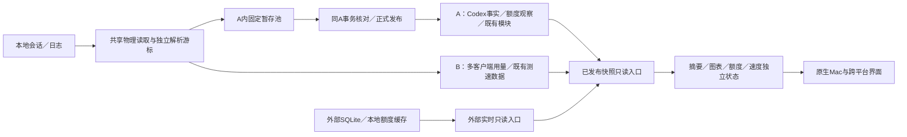

# Token Bar 整体修复方案：数据库、恢复、读取与显示

日期：2026-11-02（Asia/Shanghai）。状态：**修复方向已获用户同意；本轮完善执行方案，按用户要求在上下文压缩后开始修复。产品实现尚未开始。**

本方案已获准进入C01–C07实施；实际进度和失败门禁见[实施记录](../../maintenance/2026-11-02-integrated-recovery-progress.md)及[压缩后接续](压缩后接续.md)。尚未完成整体验收，未改用户正式数据库、安装、替换、重启或发布。本文是修复总纲，替代[11月1日旧稿](../2026-11-01-ledger-backfill-repair-plan.md)中的架构决策；旧稿作为版本分类及调查历史保留，不代表当前实施状态。执行时配合[执行清单](执行清单.md)，不再从历史对话猜测。

## 1. 目标、依据和决策范围

目标是用户从现有版本直接覆盖更新到一个修复版R，保留全部可证明的旧账，并能正常读取、恢复、增量统计和显示。已知中断及部分迁移状态由程序自动接续，不要求逐版安装、清库或手工删除清单。恢复处理和新的普通使用不再相互阻塞整个应用。

R建议使用新的0.9.12版本号、Mac构建号至少991；实际构建前核对占用情况。0.9.11的tag、签名包和撤回记录不重写。

本稿固定分析基线：

| 对象 | SHA／证据 | 含义 |
|---|---|---|
| main | `d831ae416c78f9f1950e8b4ed9755c8718a5b51d` | 当前审查基线 |
| [PR #7](https://github.com/hututuo/codex-token-bar/pull/7) | `faa06a5b9ef0d091cf06a0b2edf0e938bdd466f2` | 16项跨平台修复，作为改动来源逐项审查 |
| [PR #6](https://github.com/hututuo/codex-token-bar/pull/6) | `41058ffe4b59fb921d2bdf962db1d0624aac9b87` | 草稿，恢复／诊断／规模验证来源，不视为完成 |
| F03脱敏包 | 包内版本0.9.10，源码`1b12dc36…` | Windows现场摘要、错误和SQL复现；不含真实SQLite库 |
| Mac现场 | 0.9.8/build987→0.9.11/build990 | 已观察到大批历史补全、进度失真、MAIN表累计和重开库热点 |
| PR6规模产物 | artifact 13114990239，源码`b5e67b6…` | 512文件耗162.89秒，最大进度空窗128.59秒；4124未运行到，整组FAIL |

两条PR头部已在本轮重新读取，仍与上表相同。后续头部变化应重新审查增量，不能自动沿用本稿的接受结论。[逐项审查证据](../../maintenance/2026-11-02-pr-repair-coverage-review.md)记录代码位置、运行身份和本轮67项前端回归结果。

### 1.0 PR7修复保全门禁（本次评审补充）

PR7的16项修复行为先形成独立基线；审查后保留的实现不因“结构更统一”而重写。下文“修改后采用”首先表示必须满足整体合同，不自动授权重写其内部实现。尤其F07/F08，应先保留已验证逻辑，补齐一致性／生命周期／性能测试；只有测试或profile证明现实现不满足合同，才做有范围的更改。

允许修改PR7实现的依据限定为：可复现的遗漏／错误（如外部state缺可选列）、与账本发布／权限／来源合同的确定冲突，或者实际性能门禁不通过。代码风格、文件拆分偏好和未经验证的推测不是本轮重写理由。

实施门禁：

1. 对固定PR7 SHA建立16项问题→修复入口→测试→预期行为的映射，保留原测试；需要重现条件的fixture另加，不把源码与预期一起改成自证。
2. PR7单独基线、每组增补、最终整合使用同一输入跑比较。既有Token／费用／去重／身份结果保持；改变结果须对应本方案明确缺陷，并有独立预期和修正证据。
3. #6增补、Mac性能／固定池、启动可用性修改分开提交和验证。一次失败能定位到具体增补，不用整包互相覆盖试错。
4. 同一组修改若使PR7任何已保留修复回退，先撤回该增补或修正冲突；不删除旧测试、放宽断言或拿“新方案”解释掉回归。
5. 全部16项、旧账保护、版本恢复和规模门禁共同通过才封候选。本方案不让用户先装一个只通过一部分的新版本来继续定位。

这条保全门禁优先于后文的实现建议。独立判断PR7是否适合整体软件，不等于拒绝已经正确且经过验证的实现。

### 1.1 不变的产品与数据口径

- A=`codex-ledger.sqlite`，B=`multi-client-usage.sqlite`。只保留这两个长期业务写入数据库；外部客户端数据库不归本程序所有。
- Codex原账、已有ID、来源归属、修正／留存证据、可逆去重及历史价格继续保留。B已有用量、正文测速历史、偏好和上报状态按原owner保留。
- compaction计账和缺口语义保留，不因性能修复再提高parser revision，不人为触发第二轮全量历史重算。
- 速度条、Agent Speed上报和Codex正文TPS保持原来的独立口径；本次不改测速算法、阈值、模型颜色、价格表来源或上报授权。
- Claude相关能力只读本地；本次不增加Anthropic请求、不因恢复或检测自动打开联网额度／上报。
- 保留既有主页面、一级／二级／三级菜单结构和功能。仅修正状态、生命周期、权限、显示一致性和必要恢复操作，不再做主页改版。

## 2. 整体数据结构与职责

这是职责图，不表示所有客户端事实都经Codex Exact解析器，也不表示A与B能进行跨文件WAL原子提交。

### 2.1 四种数据不能再混用

| 类别 | 包含内容 | 可做什么 | 禁止的混用 |
|---|---|---|---|
| 原始客户端来源 | JSONL/zstd、Codex state、Claude本地日志／缓存 | 读取、验证、生成本程序投影 | 不写外部数据库，不把其变化视为本程序旧库改写 |
| 已发布历史事实 | Token组件、稳定ID、来源、已知修正和留存 | 按既有规则原子接续 | 不因缺原文或派生重建失败清零／删账 |
| 可重算投影 | canonical重复排除、模型／费用汇总、图表、排行榜、周期 | 从同一可信事实版本重算 | 不把派生缓存当作替换历史事实的依据 |
| 工作状态 | 导入操作、暂存任务、重试、进度、诊断 | 接续、暂停、核对、按回执回收 | 不把任务失败写成容器整体失效，不把日志当账目 |

物理事件保留；canonical排除关系可逆。所有普通数值查询继续使用同一canonical语义。结构导入应逐行保全；之后已知会计修复若产生数值变化，必须有原有correction／留存证据，不能用“总量必须不变”阻止合法修正，也不能借修正之名覆盖不明差异。

### 2.2 全软件各模块的接入与隔离

| 模块 | 接入本次整体修复的方式 | 保留的产品约束 |
|---|---|---|
| Exact／费用／canonical／周期归因 | 同事实与发布合同，统一reader和恢复调度 | 旧数值和修正证据保留，历史价格按原日期 |
| 额度与套餐／重置卡 | 当前观察独立刷新，历史读者按账户／plan／limit核对 | 不因回算隐藏实时额度，不改变既有Codex请求链路 |
| TPS／速度条／活动曲线 | 使用已有独立owner；只读各自已发布结果或内存采样 | 不把正文TPS混入上报，不重扫老压缩日志测速 |
| 雷达榜上报 | 保持已有授权、队列和有界自动重试 | 数据库恢复不自动开启上报，不上传对话／账号凭据 |
| 缓存提醒与排行榜 | 用相同请求事实，明细分页和整轮权重保持 | 不因查询优化漏请求；旧会话恢复／子Agent既有规则回归 |
| 会话目录／自动续跑 | 列表、压缩上下文独立轻读取 | 列表动作不触发模型生成，resume执行许可不扩大 |
| ModelTrace检测 | 保留既有设置、结果owner和账本接续 | 不因迁移、启动或测试自动发起收费检测 |
| 主页面／三级详情／侧栏 | 同一原生快照合同，保留各自布局与设置 | 来源切换、菜单排序／显隐、颜色和已读引导不重置 |
| 更新器／恢复页 | 同一启动状态、权限和诊断入口 | 原签名、公钥、Bundle ID和撤回状态不改变 |

框架／数据库层修复不借机改这些模块的产品口径。对应交叉回归纳入最终整合门禁。

## 3. 三个明确的数据库入口

不再用一个接受任意路径的`open_read_only_index`承担三种职责。

| 入口 | 参数／能力 | 生命周期 | 失败结果 |
|---|---|---|---|
| `PublishedLedgerReader` | 已注册owner／分区句柄，只读published | 受控长连接、每次短只读事务 | 保留上次有效快照，返回明确读取状态 |
| `ExternalSQLiteReader` | 经路径策略验证的外部来源，只读 | 每个活跃来源一个串行owner；文件替换后重开 | 该来源元数据保留last-good；不导入、不注册到A |
| `OwnedLedgerWriter` | 明确模块、操作及允许写入范围 | A/B各自受控writer队列 | 回滚或保留pending，不改变其他owner |

1. Published读者只检查已有注册和容器身份，不进行register、旧库发现、导入、DDL或维护，不为读取等待注册写锁。
2. 外部读者使用真正READ_ONLY并设置连接级query_only；不使用immutable读取活跃WAL，不向外部库发checkpoint或ALTER。
3. 只有首次恢复或用户选择的新来源接入进入导入器，普通刷新不会重新扫描旧迁移目录并导入。
4. Windows路径编码与路径权限分开：正确编码verbatim／中文／`#%`，不因此放宽既有UNC、重解析点、用户Home和本地盘限制。
5. 测试和产品调用相同入口。fixture只替换根目录、时间、故障注入和授权对象；不因cfg(test)改用另一套存储路由。

### 3.1 外部state的新鲜度

采用稳定只读连接上的`PRAGMA data_version`作为其他连接提交的变化信号；它只能比较同一连接前后的值，不跨连接持久化成全局版本。每次实际读取打开短事务，得到一致行集合，随后及时结束事务。该行为依据[SQLite data_version文档](https://www.sqlite.org/pragma.html#pragma_data_version)和[WAL一致读说明](https://www.sqlite.org/wal.html#concurrency)。

- 文件身份、schema列集、读取版本分开缓存。主文件或选定物理来源替换、schema变化、休眠恢复或连接重建时强制重新读取。
- mtime／大小／WAL身份用于变化提示和替换检测，不再作为“数据没有变化”的唯一证明。
- 没有可复用连接时，活跃WAL来源按既有刷新节奏重新只读；不比较不同连接的data_version。
- Windows须使用短连接：本次实施核对锁定依赖`libsqlite3-sys 0.35.0`的Windows VFS只设置FILE_SHARE_READ／FILE_SHARE_WRITE，不共享DELETE，长期保留外部句柄会阻碍来源替换。每轮真正读取后比较元数据内容；不能用跨连接data_version或未变stat跳过读取。Mac保留同连接变化检测。两端仍返回一致的已提交元数据语义。
- 并发正常提交不会使一个有效SQLite快照自动作废。可以发布本次已提交快照并立即排下一次刷新；实际文件被替换／权限异常／SQL结构损坏则保留旧值。
- `id/title/更新时间`等必需字段校验；`preview/first_user_message/updated_at_ms`等可选字段按实际列投影。缺可选列不ALTER来源，也不把整个线程集合读成成功空数组。
- 外部state变化不改写Token账本checkpoint，旧版误导入的state分区停止作为实时读取源。它的清理单独做所有权与引用证明，不连带清理真正Exact账。

## 4. 启动与恢复：账本可用性和操作进度分开

### 4.1 状态模型

容器状态回答“既有发布账是否可用”；恢复操作回答“这一次接入／转换走到哪里”。二者不能共用一个`importing`开关。

| 状态层 | 建议状态 | 主要使用者 |
|---|---|---|
| 容器可用性 | absent／preparing／available／unavailable | 启动协调器、读写门禁 |
| owner可用性 | last-good／ready／paused／conflict／unverifiable | 某Home或客户端的读取／发布 |
| 操作阶段 | planned→snapshot→normalize→validate→publish→completed；旁路paused/failed | 恢复调度器、诊断和重试 |
| 数据新鲜度 | fresh／stale／unknown | 各展示模块 |

正常退出／重启不是一个新迁移。操作输入、规则和目标相同则接续同一operation；输入真的变了再建立子attempt，保留旧证明。

启动响应保留现有phase作为兼容外壳，增补按owner划分的读／写capability及operation状态。runtime先有窗口和服务外壳，各模块按能力惰性启动。每个业务命令在服务端按当前scope／epoch和所需能力再次检查；不能只在React隐藏按钮，或简单把全局ready设成true就放行所有writer。首次A未验证时Exact writer仍关闭，B、实时观察等是否可启动由其自身依赖决定。

### 4.2 已有ready A，接入新旧库失败

推荐处理：

1. 根结构、初始化标记、文件身份以及已发布owner经验证后，先开放这些owner的读者；界面读取上一代完整发布。
2. 新来源接入单独创建操作，不把ready改回全局importing。空间检查在开始该操作写入前完成。
3. 新分区在staging状态不可见；替换既有分区必须比较目标基准证明，写锁内再次CAS核对，不能覆盖运行期间新账。
4. 空间不足或锁忙，只暂停该操作。若新来源可能影响同Home去重／历史归属，则暂停该Home新的精确发布，保留它的旧完整代。
5. 无法确认影响范围时，收紧Exact新发布，而不是让已验证旧账、实时额度、速度、B中无关客户端和整个窗口一起消失。
6. “当前总览包含哪些已验证来源”和“尚有来源待接入”分别记录。未接入来源不冒充0用量，也不把已有账改成全局未知。

### 4.3 已经被旧版留成importing

| 遗留状态 | 自动处理 | 不做什么 |
|---|---|---|
| initialized存在，原ready发布证明仍可验证，仅新增操作未完成 | 验证完整旧owner后恢复其可用状态；接续新增操作 | 不直接把字符串改为ready |
| initialized不存在，属于首次bootstrap，部分分区已导入 | 绑定原快照和已导入证明，完成所有已发现输入后首次激活 | 不让部分A冒充完整升级 |
| 已有A缺失但initialized存在 | 保留材料，验证是否有完整可信恢复来源 | 不新建空A，不用过期旧副本覆盖 |
| 目标已有冻结快照之外的新记录 | 旧账继续保留，冲突操作隔离 | 不执行replace重试 |
| pending输入当前目录找不到，但其来源回执和一致备份完整 | 使用已绑定备份继续该操作，维持原逻辑身份 | 不重建原目录伪装原件还在 |
| 真正缺少可信已发布事实、未知根合同或物理损坏 | 该容器／owner写入保持关闭，其他可信能力可用 | 不猜账、不把失败变成成功空库 |

首次升级期间窗口先显示，并可展示已验证的旧发布快照和各模块状态；业务writer仍受实际准备门禁约束。没有可信旧快照的模块保持“恢复中／不可用”，而不是显示0。不会为了看起来能启动而放行未验证writer。

## 5. 从各版本升级：按数据状态分流

重点覆盖0.9.7–0.9.11，兼容更早受支持格式的既有入口继续保留和回归；不在产品上新增一串用户必须逐版安装的步骤。

| 安装起点 | 常见数据形态 | R路线 |
|---|---|---|
| 0.9.7 | 独立Exact／quota／测速JSON，可能有13/14双副本和已完成旧清单 | 含WAL快照→已知结构正规转换→保护性历史核对→按来源导入A/B→发布 |
| 0.9.8 | 已有或部分A，v1 pending，旧独立库仍保留 | 绑定冻结证明；恢复首次/迟到操作；已ready分区不重灌 |
| 0.9.9 | 上述状态，加双候选、旧清单修复中断 | 来源谱系和覆盖比较；同内容alias登记消费，不相加 |
| 0.9.10 | compaction解析规则已改变，可能补全未完成或旧stage边界较短 | 保留已发布事实与已完成任务，适配旧stage，按当前规则补剩余 |
| 0.9.11 | 恢复继续推进；可能大量stage／已完成但残留材料 | 正常分区直接可用；完成任务不再解析；不再提高parser规则 |
| 曾在中间版本退出／重复启动 | building、sealed、pending、已发布未清理等组合 | 按第6–7节的操作和消费回执接续 |

### 5.1 保留已有的旧清单处理

完整阶段矩阵保留：prepared/copied/migrated/validated只处理私有候选；switching的主库缺失窗口才允许验证rollback；switched/retained不再视为迁移未完成。candidate不作为已提交账目来源；主库在完成后丢失不能拿较旧rollback冒充最新账。Mac遗留retiring仅按其已知来源合同识别，不给Rust增加任意新phase。

### 5.2 两份旧库与F03现场

- 相同快照、真实搬迁alias、已知13→14附加结构变化、被较新账完整覆盖的旧账，分别有明确比较策略。
- quota维护时钟与真实观察分开。已知policy的维护时钟合法前进不能被当成改写旧观察；账户claims、旧观察、未知字段仍保全。
- Exact运行元数据、已知解析修复、指纹／位置从未知到已知的补全，与数值事实变更分别核对。保留0.9.11已加入的类型与来源证明，不再做“忽略所有metadata”的放宽。
- 两份各有独有消费、稳定身份数值冲突或来源无法证明时，不按mtime选库，不直接SUM，也不全局关掉可用账。
- 原始JSONL已缺失：保留已发布消费、canonical投影、留存和correction；不因为无法重扫就删除或将available改成true。

这套流程覆盖已知遗留状态，不承诺从不存在的原文／备份凭空恢复事实。未知状态保留完整材料并隔离影响范围。

## 6. 暂存与性能：一个固定池，按任务存行

### 6.1 架构取舍

推荐在A内新增一个**专属固定namespace**，按job_id存任务。保持A容器合同1、Exact主schema14和当前parser revision；池使用自己的`stage-pool-v1`格式。

| 选项 | 取舍 |
|---|---|
| 继续每job四表，仅复用连接 | 不能消除MAIN目录膨胀和DDL缓存失效，不作为最终方案 |
| 新建第三个长期stage数据库 | 违反两个长期业务库边界，并增加跨库提交/回执恢复，不推荐 |
| 本次整体复制/重建A | 加大空间、切换和历史证明风险，不作为本轮默认 |
| A内固定池、任务行级封存 | 推荐；消除job级MAIN DDL，并可同A事务绑定发布与消费 |

### 6.2 固定池结构

固定六表及有限索引/约束，在首建时一次创建：

| 表 | 内容 | 不变量 |
|---|---|---|
| operations | owner、输入集合、基准发布、操作阶段、重试原因 | 同输入接续；失败不改变容器可用性 |
| jobs | 来源合同、parser状态、格式、计数、摘要、building/sealed等 | 封存后事实字段不可原地修改 |
| event_rows | 按job＋ordinal保存待协调事件 | 无聊天正文；无损保存字段和值类型 |
| fingerprints | job的去重／响应身份材料 | 不跨Home/会话猜测相同消费 |
| chunks | 来源块索引、有效字节数、摘要 | 证明本任务正式扫描前缀 |
| publication_receipts | owner/job/内容摘要/正式发布代 | 与正式账同事务写入，防重放 |

事件payload使用显式版本的无损行编码，保留Int64、REAL位、NULL、TEXT/BLOB和时间单位；Swift/Rust保留各自布局codec，不能经JS浮点或本地时间字符串中转。codec和parser是不同版本标记。共享SQL／fixture描述共同头、约束、摘要和状态；不强行改变两端原始账本表结构。

### 6.3 必须改造的适配层

此前旧稿只写“固定六表”不足以实施。现有API有以下冲突，必须一起处理：

1. **专属身份**：采用独立pool模块／稳定logical URL，不伪装为`exact.swift.stage`或每路径一个`exact`分区。目录注册、六表DDL及池版本同事务完成；pool与旧逐job stage枚举路径隔离。
2. **按job封存**：现有`seal`会封存整个store，不能复用来封一个job。池保持可写，payload由job级状态和事务约束保护；封存摘要、字段布局及来源证明不可改写。
3. **按job清理**：禁止对pool调用`removeCompletedStage/remove_store_namespace`。只有带owner、job、消费回执和摘要的行级回收入口能删除payload。
4. **跨namespace原子发布**：现有SQL facade一次只绑定一个store，不能直接向池写回执。新增受限的同A连接事务协调接口，显式绑定已验证的目标账本与pool句柄；不开放任意前缀SQL，不把两次独立事务拼成“原子”。
5. **版本门禁**：reader/writer都检查pool版本、codec、schema合同和job状态；未知pool只暂停补全，旧published读者继续。不能靠根容器版本1推定池可写。
6. **不可变约束**：封存payload的改写在底层被拒绝；消费后按回执转入可回收。Rust旧整店sealed标记本身不等于连接只读，不能继续依赖它提供写保护。

跨namespace协调器拥有一个writer连接和两个不可变的已验证SQL映射，不能在同一连接安装两个相互覆盖的单store TEMP目录视图，也不能拿已query_only的reader句柄当writer复用。业务模块继续只能提交自己的类型化操作；跨scope能力仅交给正式发布协调器，包含越界拒绝、故障回滚与statement绑定测试。

为同一A创建的pool只有一个。首建之后，同一批既有Home新增1、100、4124个job，MAIN对象数及注册store数不随job增长。新增Home自身合法的正式结构不计作job增长，测试将两者分开。

### 6.4 任务合同与来源继续写入

任务头固定owner、session归属规则、parser、正式扫描前缀、初始parser/checkpoint状态、块摘要和基准发布。来源mtime只作观察，不单独决定“同一个事实”或“全历史重建”。重试沿用持久operation，不在每次刷新重建全部job ID。

- 同合同、完整验证通过的sealed任务直接复用。
- 旧完整stage只覆盖较短前缀：它是旧合同的有效材料，不是坏库。保留原件/证明，为较长正式前缀建立新job；可证明的既有append路径才能补后缀，否则最多重解析这个来源，不反复重建全部来源。
- 正常追加不推翻已冻结扫描上界；只验证该上界以内未变。下一增量处理新增尾部。
- 重写／截断／替换是另一类状态，旧未发布任务保留为superseded，重新计划受影响来源，不盲改hash继续。
- base发布已经推进时，先重新核对事实基准；仅可证明可复用的解析材料复用，协调／发布重新做，不直接把旧base回执改成新base。
- 同一来源持续变化时暂停新attempt并退回正常刷新节奏；不每秒制造一个candidate或整轮重扫。

来源前缀／压缩帧和文件身份的最后验证绕过共享字节缓存。缓存可以减少读取，不能拿缓存本身证明原文未变；Windows路径形式差异也不能改变原receipt的逻辑来源身份。

旧哈希最早由哪个版本写入仍是调查项。修复不能依赖先猜出该版本：独立物理前缀校验决定合法追加／真实改写，旧证据保留；验收同时覆盖两种原因，不能以删除checkpoint使测试通过。

### 6.5 旧stage兼容与回收

| 旧状态 | 处理 |
|---|---|
| 当前parser、完整、同来源/合同、完整性通过 | LegacyStageReader直接适配；可以从旧artifact发布，不强制先复制全份payload |
| 已知旧parser完整stage | 保留；不冒充当前compaction完成；可用原文按当前规则补该来源 |
| 已知早期manifest/v0布局 | 独立格式reader识别，精确检查表/列/owner/计数；不把缺版本字段当未知，也不补成当前版本伪造完成 |
| building未封存 | 不当正式账；保留已封存其他job，只重做未完成来源 |
| 合格短边界stage | 按6.4处理，不占用新任务唯一地址 |
| 已发布但未清理 | 按正式消费回执幂等回收，不再次计账 |
| 未来、未知或损坏合同 | 保留／隔离该job；保持旧发布可读，不覆盖或按文件名删除 |

旧namespace消费回执在A内持久提交后才回收。证据格式和owner不明的约1.55万张非stage表继续保留。旧stage的后台清理按对象数／时间预算分批，不是启动条件，不做全库VACUUM。

## 7. 写入、连接与原子发布

### 7.1 调度

- A和B各自有受控writer，普通读者使用只读连接。连接由actor／串行队列独占，不在多worker之间共享可变binding。
- 解析workers按资源预算1–4个，使用有界缓冲或连接内TEMP，不持有A写事务解析文件。
- pool批次提交按行数和字节双上限，首选约512条／1MiB；受限大记录单独处理。额度观察等小写入在批次间获得机会，不等整轮解析。
- seal／byteCount／observation使用现有任务连接和job头证明，不逐文件新开A；目录注册缓存只因明确结构改变失效，普通数据revision不触发重新安装全目录。
- 既有大量表作为性能输入保留。缓存优化不能绕过文件身份、目录变动和来源证明。

### 7.2 两端发布边界保持

| 平台 | 本轮保留的发布方式 | 消费回执位置 |
|---|---|---|
| Swift | 整轮外层事务，内部savepoint；数值、canonical、图表、周期归因、generation和扫描证书一起提交 | 同物理A、同事务的pool回执 |
| Rust／Windows | 既有durable pending/building；最终一个事务发布实体／canonical／聚合／generation／证书 | 同最终事务的pool回执 |

正式提交前复核源前缀与目标基准；同owner/job同摘要的回执幂等跳过，不同摘要拒绝。进程死在commit之后、清理之前，下次只回收，不重复导入。pending/未封存行不进入普通读者。

扫描证书记录每个来源实际验证的前缀和观察范围，不宣称对客户端持续写入的整个目录取得同一物理时刻的快照。SQLite内的正式代和其图表／证书是原子一致的；新的外部尾部由下一次增量处理。

不为缩短写锁把Swift半轮数据提前发布；若最终发布过慢，先解决查询／索引／重复证明，不能以拆坏原子性通过性能门禁。

### 7.3 小写入等待与失败

正式提交期间小writer可能等待，界面不能同步等待或清空旧值。不可重建的额度变化排队保留，不以“只保留最新一次”丢掉重置／回弹观察。相同payload可按现有去重规则处理。队列有界，超限停止生产者并明确状态，不静默丢弃。

锁忙重试当前步骤，有上限和退避；不重启整个应用或重新解析所有旧文件。速率原始点仍按现有近三分钟内存策略，不因此建立新的速度历史数据库。

入队和持久化成功是不同状态。只有所属业务库事务确认后才报告“已保存”；尚在内存等待的观察不得被视为已落账，跨进程测试明确这个边界。不能为缩短等待新增第三个长期队列数据库，也不能丢掉已接收记录后报告成功。

## 8. 前后端快照与页面一致性

### 8.1 显式区分各lane

同一页面有摘要、完整统计、额度、速度、会话目录等独立owner。它们可以不同时间完成，不能共享一个不断前进的“总revision”。

| lane | 权威版本 | 能更新的内容 |
|---|---|---|
| Summary | 该来源的摘要事实／Exact水位 | 今日／累计／模型摘要，不覆盖旧完整图表 |
| Full | 该来源正式发布代＋聚合版本＋价格版本＋覆盖边界 | 图表、缓存榜、选区费用和关联归因 |
| Quota | 账户／plan／limit＋观察时间／本地周期投影版本 | 对应额度，不因Full失败消失 |
| Live | 客户端／来源／采样序列 | 速度、任务状态，不等待历史回算 |
| Catalog | 本地目录／state快照版本 | 会话列表／标题，不要求先补完账 |

复用已有`aggregateExactGeneration`等字段分别跟踪两个lane的有效版本，先验证PR7现有适配是否已满足合同，不强制立即重写整棵状态树。适配时剔除不属于该lane的revision可以是正确做法；禁止的是丢掉该lane本来有效的版本来接收任意结果。反例证明现有字段无法表达时才拆状态／新增兼容可选字段，并提供老载荷适配，不一次推倒所有DTO。

### 8.2 接收规则

- 同Home／客户端scope、同请求epoch才能更新该lane。切换来源或卸载后的晚结果丢弃，其他来源不被覆盖。
- 同lane可信版本前进才替换；代际不明时保留last-good并安排权威只读，不能仅以generatedAt较新认定事实更新。
- 摘要领先时，完整结果若比上一次完整聚合更新仍可接收；摘要保留在自己的槽中。不能拿摘要的版本去拒绝Full。
- 成功空结果、来源未接入、读取失败、未完成扫描是不同状态。失败只更新status／诊断，不用空数组或0覆盖可信数字。
- 请求reason/revision/dedupe/owner持续到任务真正完成；UI等待预算耗尽只是“仍在进行”，不是完成或取消。真正取消要显式释放订阅并核对native owner。
- 多客户端合计记录A发布代＋B发布版本＋共同统计区间的版本向量。A/B不假称跨文件原子；暂缺来源标识为部分覆盖，已知部分保留。

### 8.3 原图表、金额和额度语义

- 24h／7d／30d、费用、缓存榜和额度线保留原功能。图表、气泡、底部选区卡和反推使用同一不可变选区快照／闭合桶边界。
- 选区过程中新摘要／图表到来不把最后一格映射到另一代金额。已固定选区要么沿用原快照，要么明确失效重选，不暗中混合版本。
- 额度百分比不跨Codex／Claude订阅相加；总Token和API等值费用可按客户端聚合，但来源、历史价和缺口各自保留。
- 额度反推仅用匹配账户／同周期／同来源的可比区间；未报告compaction缺口仅影响重叠区间。Auto Review继续单列且不进收费总额／额度价值。
- 保留按已用量下降识别周期、可撤销假重置、按账户隔离、服务器重置时间仅显示等已定口径。本次不重新换周期算法。
- 客户端检测／启用不等于读到某项能力。没有实际速率的客户端不画速度标签；没有本地Claude额度就不伪造窗口；正文TPS仍只属于已有Codex口径。

额外关联核对：当前Swift `SharedAccountUsageAttribution.swift:1820`仍以“过去七天存在未报告compaction”提前返回全局归因不可用。这里应改成实际比对segment／周期区间及来源的交集：区间外缺口不阻断当前比较，区间内保留已知消费小计，仅相关推断不可用。这是已核对源码的边界修正，不撤销未知usage保护，也不改已定周期识别算法。PR7的F09样式修复本身没有完成这项语义核对。

### 8.4 归因发布与渲染

先保留#7消除父子反馈循环的已验证实现，检查实际payload、调用次数和成本。已有小型JSON签名在预算内可保留，不凭推测替换；本轮不把全对象JSON.stringify扩展为全软件每次render的通用比较。

目标合同是按source／owner／事实revision或稳定签名发布；墙钟、presentation props、最后检查时间不冒充新事实。卸载清理必须匹配当前owner，旧组件的cleanup不能清掉新组件结果。持久层只在有效事实变化后写入；StrictMode与callback替换都不能形成循环。优先补这些反例测试，再对确有缺陷的范围作小修改。

## 9. PR7的16项：逐项采用决策

以下是实施取舍，不是原样接受整个PR。代码可复用，最终仍以本方案的系统边界和组合测试为准。需要直接整合的是F01/F02/F03/F04/F10/F16；F06/F11/F14按原算法整合并验证底层变更；F05/F07/F08/F09/F12/F13/F15优先保留当前实现。F12仅在实际限额测试暴露缺口时补充保护，不另写一套压缩读取器。

| #7项 | 判断 | 本方案的采用方式与补充 |
|---|---|---|
| F01 非法事件名 | 修改后采用 | 合并#6的共享hook和#7的三通道／旧键测试；保留主界面与侧栏选择独立，存储失败仍可在内存操作，异步unlisten有保护 |
| F02 旧quota缺列／来源过滤 | 修改后采用 | 只读按列投影＋稳定账户身份；保留安全legacy桥接；缺cycle元数据是unknown，既有0哨兵不当真实epoch／周期证据；不ALTER原库 |
| F03 stage合同冲突 | 采用恢复语义，调整存储实现 | 验证旧合同、保留证据、允许新任务的原则保留；旧candidate机制作为legacy适配，所有新任务进入固定池，不继续扩张namespace |
| F04 state冻结／WAL漏读 | 修改后采用 | 独立外部只读＋#6可选列＋稳定连接data_version；stat仅辅助，不把正常并发提交当坏源；不反复全量读取或永远缓存 |
| F05 Windows URI | 采用并核对边界 | 复用编码修复及真实Windows只读WAL测试；支持编码不等于授权远程／不安全路径 |
| F06 协调查询慢 | 采用，双端验证 | 约束binding双方source、TEMP incoming身份索引等优化保留；验证ID／数值／已知指纹／canonical一致；按Swift对应实现做等价审查 |
| F07 父子渲染反馈循环 | 保留修复，按证据增补 | 先保留已验证逻辑和测试；增加owner清理与实际比较成本测试，只有失败或profile证明需要时才替换比较机制，不为重构而改 |
| F08 摘要挡Full／订阅丢失 | 保留修复，强化合同验证 | 先保留已有谱系／订阅修复；第8节定义目标语义，可用现有字段与适配实现，不强制立即重写状态树。反例证明必要时才调整，原回归全部保留 |
| F09 说明文字遮挡 | 采用 | 最小样式修复，继续展示真正影响区间的缺口；不扩展成页面改版 |
| F10 子窗口权限 | 采用并整合恢复UI | 已知窗口可读状态，重试实际迁移仍限主窗口；前端URL参数只影响展示，后端window label／capability才是授权依据 |
| F11 摘要／计数／365日全量查询 | 采用，补性能与语义门禁 | 按已发布文件绑定索引查询和短快照；保留时区、边界、canonical、模型和缺失来源；验证不是把一次全扫变成数千次慢扫 |
| F12 压缩目录／上下文／恢复包 | 修改后采用 | 目录与账本补全解耦、流式解码和原始字节恢复包保留；读的过程中执行首行／输出／时间上限，不等读完整超大行后才报错 |
| F13 会话列表超时 | 按能力采用 | 支持时state-db-only列表；保留分页、来源、排序和取消；只在明确不支持参数时做一次兼容回退，超时不触发全量扫描循环 |
| F14 正常追加误报改写 | 采用并双端对齐 | 扫描上界冻结、验证长度读当前句柄；内容前缀／身份检查保留，重写／截断／替换继续拒绝 |
| F15 重复摘录告警 | 采用 | 同快照、同来源、同错误类别合并并保留次数；不吞其他独立错误或未来刷新告警 |
| F16 忙状态／只读等写锁／明细慢 | 拆分采用 | UI跟随真实owner；读者不走注册写入；明细在单快照分页，UUID归因仍包含所有副本；不能缩小范围换取速度 |

`useStateDbOnly`的用途在[OpenAI线程存储源码](https://github.com/openai/codex/blob/main/codex-rs/thread-store/src/types.rs)和[官方SDK参数](https://github.com/openai/codex/blob/main/sdk/python/src/openai_codex/api.py)可核对；这不证明每个用户安装的Codex版本都支持。实施时固定支持版本／生成协议证据，兼容回退按错误类型和能力处理。

## 10. PR6取舍及六处冲突处理

### 10.1 保留的工作

- 跨批累计进度、后台已知模块迁移接续、来源／状态／消费证明相关测试。
- 外部state旧列兼容、设置失败／监听清理保护。
- 持久迁移／运行补全诊断及用户导出，0.9.8–0.9.11形成状态探针。
- 保护页的软件更新动作沿用既有更新器，不借账本恢复改变更新密钥、许可或分发渠道。

### 10.2 必须修改的工作

- 不能把新增日志当成性能解决。逐源同步fsync取消为默认路径：详细事件有界异步/批量，关键操作开始／失败／提交记录保留明确持久化点。
- 账本原子性只由A/B事务和恢复回执保障，不能依赖日志写入成功。日志故障不把已提交账回滚，也不吞掉原业务错误。
- 数据库操作重试与软件更新是不同操作；“检查更新”不自动执行数据库替换。维护页若提供“检查／继续恢复”，也调用同一恢复调度器，不再写一套手工迁移。
- #6旧stage处理接入LegacyStageReader，不保留另一套新job namespace分配器。

### 10.3 冲突解决不是选ours/theirs

| 冲突文件 | 整合责任 |
|---|---|
| business_store_fixture.rs | 合并双方不变量与场景，保留独立失败收集，生产路由一致 |
| quota_history/database.rs | 单一列兼容／身份读取器，合并双方稳定身份、缺列和未认领测试 |
| token_count_jsonl.rs | 一个对外入口和调度owner，诊断及fixture扩展不能改变普通调用语义 |
| exact_usage_index.rs | 外部读者、pool适配、发布／缓存／性能查询按本方案拆职责，保留旧格式reader |
| BusinessStartupGate.tsx | backend能力状态＋#7子窗口权限＋#6诊断操作，共用一次状态机 |
| useClientScope.ts | 一套共享hook，旧设置键保留，三合法事件通道和两边测试都保留 |

以main创建独立整合分支，按功能合同选取提交／代码，不先合一个大PR再机械合另一个。#5已由#7覆盖，不再第三次叠加。整合结果的CI必须绑定最终同一SHA。

## 11. 性能、进度、功耗与诊断预算

### 11.1 进度表示

计划、已复用、解析／封存、核验、正式发布、清理分别表示；按job累计且重启可从journal恢复。100%只在正式提交成功后显示，后台清理可以另外结束。

最长每250ms合并一次UI通知；长源处理以字节进展和心跳表示，不编造完成百分比或剩余分钟数。真实完成计数不能被计时器自动推进，心跳和事实完成分开。UI工作在主线程，扫描／schema／摘要／解压／proof均在后台。

### 11.2 拟议验收预算

以下为本方案的验收目标，不是已经测得的修复效果。同一受控CI runner、相同输入、记录冷热缓存与机器信息；不改小fixture来通过。达不到目标时保留失败与profile，再评审必要的设计调整；不得自行把目标改成已达到的数字。

| 项目 | 预算／硬条件 |
|---|---|
| 已ready A启动 | 窗口不等历史补全；已发布旧数据目标3秒内可显示 |
| 新job的MAIN对象 | pool首建后，同一owner新增job导致的MAIN对象／store增量为0 |
| 512小源生产路径 | 补全目标≤30秒；任何不可解释的进度空窗不得超过30秒 |
| 4124小源＋旧大目录 | 全流程目标≤300秒，最多600秒硬上限；不能缺测；不重解析已sealed任务 |
| 50万事件／约2.5万表起点 | 两端完整生产路径完成、正确性通过，报告总时长、锁、WAL和内存；不先删除旧正式分区缩小输入 |
| 最终发布 | 50万事件夹具写锁目标≤10秒；超标优化真实查询，不提前公开半轮 |
| 普通无变化刷新 | 不进导入、不新增attempt／备份、不全扫历史；受控大库场景P95目标≤1秒 |
| 前台交互 | 不出现扫描／JSON比较占主线程的100ms级长任务；自动滚动／展开探针对比基线无退化 |
| 资源 | 解析并行最多4，按解压window与buffer预算下降；无整源Vec／无界首行读取 |
| 日志 | 批量详细日志；关键状态独立持久化；启用诊断相对关闭的耗时增幅目标≤5% |

若已知平台限制使目标达不到，应带原始profile及替代设计回到评审，不能只放宽阈值或把4124排除。单事件小文件规模通过仍不代替50万历史事件协调测试。

### 11.3 功耗与日常调度

- 一个来源一个扫描／刷新owner，同源并发请求合并；用户手动刷新可提高优先级，但不重复起扫描。
- 后台utility优先级，窗口不可见不重复计算图形／执行演示动画；隐藏模块退订展示层，账本owner按既有必要节奏工作。
- 模型／图表派生按事实版本缓存，不跟每秒时钟重建。速度近三分钟环形缓冲保持有界，平滑仅用于线段连接，不改原始点。
- sleep/wake只触发必要重检；忙锁、低空间、网络更新失败按各自有上限退避，不每秒重启子进程或全量恢复。
- 保留现有Codex持久app-server请求链路；Claude本地扫描不因本次修复产生外网请求。

### 11.4 诊断留存

权威恢复状态在A的操作／消费回执中，长期保留其必要摘要。详细诊断文件推荐30天、总50MiB有界轮换；未完成操作的关键起点／最后失败摘要保留，重复明细可以归并。清理不触碰旧账、用户导出或原始客户端文件。

导出默认脱敏用户目录、账号／会话标识，包含版本、源码／构建身份、阶段、error code、来源摘要、旧新代次、耗时和重试原因；不含凭据／对话，失败不自动上传。普通刷新成功不每次新建一份迁移日志。

## 12. 空间、备份、清理与回退

1. 第一次结构操作前获取SQLite一致快照（包含WAL）并核对；同源摘要与转换合同复用备份，不每个job／每次重试复制整个A。
2. pool首建在备份验证之后的单事务完成；失败回滚。已ready A不先改成不可用再查空间。
3. 空间预算包括待建快照、转换候选、pool数据、正式提交新增页和WAL、日志及至少512MiB余量；运行中按实际增长调整。数据量本身可能随来源增加，固定表不等于暂存字节恒定。
4. 低空间停止派发、释放未提交事务，保留旧代及已sealed任务；恢复后继续。不能清账腾空间，不在启动前跑全库VACUUM。
5. 只有owner/job/摘要/消费回执全部匹配才清理已消费payload与旧stage；未发布、未知、损坏或原文已缺失的证据不按年龄猜删。
6. 新版出现新账后，不自动用旧全库备份覆盖回去；回退优先使用能读当前合同的修正版。旧0.9.7看不到A中新账，不能宣称降级安全。也不承诺0.9.8–0.9.11旧writer能理解新pool。
7. 保留旧二进制／源版本作为诊断依据不等于允许运行它继续写同一A。已有终身writer锁与身份检查保留，降级演练不改用户正式数据。

### 12.1 历史副本具体如何收尾

| 本程序材料 | 判定与动作 |
|---|---|
| 已消费旧stage／新pool payload | 正式发布回执、owner和摘要一致，且无pending引用后回收；保留轻量消费证明 |
| 同输入重复original／normalized备份 | 比较完整内容与转换合同、确认所有恢复引用已指向保留副本后回收冗余；不能仅看文件名或mtime |
| 旧独立Exact／quota／正文JSON | 先确认来源已完整导入、模块新写入已切换且原文件无新变化，再退出发现；有可信保留快照与消费证明才进入受管回收 |
| schema11 candidate／rollback／清单 | 按已知phase和最终来源核对；未完成和最后一份原始证据继续保留；完成后的重复副本可按同一回收流程处理 |
| 升级前完整A快照 | 至少保留一份有效的升级前快照及所有未完成操作依赖；不因诊断日志30天期限删除它 |
| 无所有权证明、用户导出、客户端原始会话／state | 不回收 |

回收在后台以受管隔离／系统回收站等可追溯方式进行，记录摘要与去向；家族main/WAL/SHM按一致状态处理。动作前再次检查文件身份、应用writer占用和引用，遇变化即停止。最终删除只针对已证明的冗余程序材料，不能把整个用户目录纳入通配清理。退出扫描先于物理回收，清理失败不撤销已完成升级。

## 13. 验证矩阵与发布门禁

### 13.1 原故障先变成失败测试

| 组 | 场景 | 断言 |
|---|---|---|
| V01 | 0.9.7／8／9／10／11各自实际源码生成输入→R | 直接升级；不用改当前空库版本号冒充旧产物 |
| V02 | 更早受支持格式、13/14双副本、已完成schema11清单 | 原兼容合同继续；candidate不误入账 |
| V03 | v1/v2 pending、首次部分A、quota维护＋611条追加 | 冻结基线可核对，正常维护不被当改账，目标独有新账不覆盖 |
| V04 | 旧Exact运行状态、指纹／位置补全、fork修复、原文缺失 | 保护数值／身份／已知字段，未知到已知有证据，旧账不丢 |
| V05 | ready A＋新增旧库＋低空间／权限／中断；直接调用被暂停owner的写命令 | 旧已发布可读，相关操作暂停，全局可用性不退回importing；服务端拒绝受影响writer，其他已验证能力可用 |
| V06 | 旧版已留importing＋marker有／无、备份有／无 | 按4.3恢复，不能改字符串或建空库放行 |
| V07 | 完整短stage＋长源、缺版本旧格式、坏seal、未来codec | 正常合同可接续；未知保留；不存在固定地址无限失败 |
| V08 | pool building／sealed／已消费，分阶段跨进程强退 | 旧完整代或新完整代；commit后重启不双计、清理不误删 |
| V09 | 确认缺失、权限拒绝、归档、移动、追加、重写、替换 | 事实保留；仅真正确认缺失才走missing，正常追加不误报 |
| V10 | state主文件不变、WAL-only提交、checkpoint、替换、旧列 | 真只读、元数据更新、不注册外部库、坏结构不发布空数据 |
| V11 | 写者持锁、读已有已提交值、未知分区 | 读者不注册、不阻塞等写、不见未提交、不创建空分区 |
| V12 | 所有同UUID副本、fork继承、compaction镜像／未知usage；缺口在本区间内／外、旧周期和其他来源 | canonical／费用／归因一致，缺口只影响重叠区间，已知小计保留 |
| V13 | #7事件、渲染、lane、子窗口、列表、压缩及路径测试 | 16项对应场景在整合源码全部通过 |
| V14 | 摘要领先、Full延迟、A/B切换、卸载晚结果、失败载荷 | 每lane前进、last-good保留、旧owner不能清新结果 |
| V15 | 选区最后一格、跨午夜、24h/7d/30d、周期跳变 | 气泡/卡片/费用/反推同快照，金额不突跳，重置时间只显示 |
| V16 | B已存在／首次B仅基础表／已有上报队列 | 数据与canary、偏好、测速和许可保留，无新第三库 |
| V17 | 13/128/512/4124小源＋50万事件＋大schema起点 | 第11节正确性／性能门禁；不以cfg(test)独立小库代替 |
| V18 | 完成后连续三次跨进程重启与无变化刷新 | 不重做补全、不重复备份／导入、不新增迁移attempt |
| V19 | 清理中断、原文不存在、未知文件／未归属备份 | 清理幂等；无误删；不删除最后一份未发布证据 |
| V20 | 日志关闭／正常／写失败、磁盘慢、窗口隐藏／唤醒 | 账务结果一致、CPU／内存／日志成本有界 |

所有输入登记平台、源commit、结构／typed-row摘要和形成步骤。脱敏包SQL复现继续保留，但它不替代生产入口。客户原库不上传CI；本地只读核对或经过授权的隔离副本另记录范围。

### 13.2 对账与性能都必须过

- 结构导入：逐主键、类型、行号／sequence、关系及来源证明；不只比SUM。
- 语义补全：旧事实、合法修正及canonical重复排除分别审计；数值改变要可解释，未知使用不猜成0。
- 一次完整发布后，摘要、图表、费用、排行榜与周期归因在同一范围可交叉核对。
- 双端全量Swift／Rust／TS／UI，加非cfg(test)生产恢复和上述规模测试，绑定同一个整合SHA。
- 构建及大测试以云端为主，本地做必要小探针和只读核查。普通bug不以反复替换用户正式应用作为测试手段。
- 分支原有绿色CI只作为来源证据；整合分支重新验证，失败不靠删用例、缩样本或放宽权限解决。

## 14. 实施顺序和交付物

用户已同意修复方向，要求先完善方案、上下文压缩后修复。下面是内部提交批次，不是多个用户更新版本；具体依赖、路径、失败处理和证据要求见[执行清单](执行清单.md)。

| 批次 | 工作 | 交付／退出条件 |
|---|---|---|
| C01 | 固定基线、PR7的16项保全映射、原故障失败测试、共享数据／状态合同 | 版本与输入可追溯；PR7独立基线可比较；明确现有失败，不先合PR |
| C02 | 三类数据库入口、旧列／路径／事件／lane基础整合 | 读取不走迁移；UI不再因读取失败清空数据；相关回归通过 |
| C03 | 固定pool、job级seal／清理、同A跨namespace发布桥 | 首建／故障／重复启动正确，无job级DDL，旧reader可接续 |
| C04 | 启动可用性与操作分离、遗留importing／旧库恢复 | V01–V08完整通过，旧账和目标新账不丢 |
| C05 | 查询／压缩／目录／追加性能，双端对应路径优化 | V09–V17和规模门禁通过，记录各阶段profile |
| C06 | 诊断成本／重试／恢复页、生命周期／隐藏窗口功耗 | 无同步刷盘热点、无重试风暴、权限不扩大 |
| C07 | 全量组合、数据对账、三次重启、封候选 | 同SHA测试／报告完备，无未解释的账目变化 |

root负责整合、数据/架构决策、冲突与最终质量；可用独立只读核查辅助，不把多个子任务的“通过”直接拼成发布批准。

最终交付：源码提交链、采用／修改／未采用PR项目清单、每版本恢复矩阵、差异对账、失败注入证据、性能与功耗报告、回滚材料和已知边界。任一数据保护或主要性能门禁未过，R不封正式更新。

本轮完成文档检查点；压缩后可直接从C01继续，不重复请求开始实施的授权。合并main、替换／重启正式版、签名／发布等待用户后续明确指令。当前撤回的分发状态不因方案完成或测试通过改变。

## 15. 已确定的七个决策

1. 保留两个数据库和旧账，采用A内固定暂存池，不做全库重建。
2. 有可信旧账就先可读；恢复后台进行，问题按owner隔离，真实损坏不假装正常。
3. 保留#7的有效修复方向，按系统合同改造16项，不原样接受；合并#6有价值部分，修改同步日志和存储冲突。
4. 摘要、完整图表、额度、速度独立版本；保持原有页面和统计口径。
5. 自动处理已知历史状态，用户无需手工删库或逐版安装；未知冲突保留证据和已知数据。
6. 同一整合版本完成双端真实入口、近期版本和4124规模验证，不通过不发。
7. 先保存完整方案与执行状态，压缩后实施；不等同于授权合并main、替换或发布。

## 16. 收束要求：本次必须结束哪些并行逻辑

修复应减少生产路径的分叉。不能只新增一层入口，同时让旧调用继续走旧流程；也不能以删除旧格式支持来换取表面整洁。

### 16.1 本修复版的退出条件

| 对象 | 本次唯一正常路径 | 允许保留的旧路径 | 退出证明 |
|---|---|---|---|
| 新Exact暂存 | 固定pool的job writer | 旧stage只读适配，以及带消费回执的受限清理 | 产品新job不再调用逐文件建表／store注册；已有Home新增4124 job的MAIN对象与store增量为0 |
| 旧库接入 | 一个按实际状态分流的恢复调度器 | 已知schema／manifest的格式适配器 | 启动重试、保护页重试和首次升级落到同一调度器；无第二套手工导入器 |
| 业务只读 | published reader | 显式隔离的旧库核对reader | 完整生产调用图和测试证明普通读取不触发导入、register、DDL或维护写入 |
| 外部state | external read-only reader | 旧列集的动态投影 | 外部来源不成为A的实时快照分区；WAL-only变动可见，旧冻结副本不再参与实时选择 |
| 共享设置事件 | 一套hook与合法通道 | 既有localStorage键的读取兼容 | 不重复注册两套监听；存储失败、卸载晚回调和异步unlisten测试全部保留 |
| 快照接收 | 每lane一个接收策略 | 旧载荷到现有合同的兼容转换 | 保留PR7 F07/F08回归；摘要与Full各自前进，无旁路放行任意结果 |
| 版本判断 | 表／字段／manifest／codec／事实证明 | 已知旧结构分类器 | 日常业务不靠安装版本串分支；版本号只用于来源说明和验证输入 |

“只读适配器”不等于只能用一次：长期未更新的用户仍可直接升级，旧原文缺失时也要读取其可证明的账。退出的是旧的新写入路径和重复调度，不是用户的升级资格。

不得设置一个长期默认开启的“双写观察期”，把每个新job同时写新pool和旧四表。迁移前后的比较只在隔离fixture或明确测试模式下执行，不对用户正式账双写。若某个适配无法满足不变量，暂停该增补，不能退回两套正常writer并行。

### 16.2 本次顺便收束到什么程度

新增职责仅限来源只读、旧格式识别、pool任务、正式发布及恢复状态；跨namespace桥仅服务经过验证的Exact＋pool组合。优先利用现有文件和类型，必要时提取小模块，不构造所有业务都必须接入的通用数据库框架。

必须在C07提交实际调用点清单：哪些入口被替换、旧入口剩下哪些调用、分别为何保留，以及禁止入口的生产回归。不可达的重复函数和已被新路径完全取代的临时开关在本轮删除；不能用TODO承诺以后再收束。

### 16.3 后续可以做，但不是本次修复的前置条件

1. **代码整理**：稳定后可以按来源／事实／投影／恢复／暂存继续拆分大文件。每次只移动职责，保持调用接口和数据库合同，不伴随schema、parser、计价或周期算法升级；先跑相同输入结果比较，再删除重复薄包装。
2. **物理收纳**：历史namespace、旧备份和回滚副本先列清单，满足第12节证明才后台回收。是否进一步压实A取决于真实剩余体积和查询成本；不预设又来一次全库搬迁。
3. **适配层维护**：每个旧格式登记可识别范围、来源版本和测试。未来停止支持必须另行决策，不能因为格式老就删除唯一恢复路径。

后续重构与本次R使用不同提交／验证报告，不能将“以后重构”写成这次缺项的验收理由。C07通过才表示本次修复完成；发布与用户现场反馈另有边界，不宣称再无未知bug。
