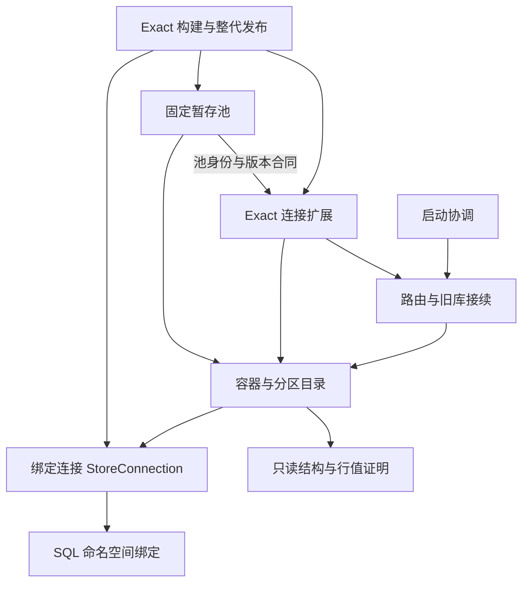

# 存储链整体复审与分步拆分方案

日期：2026-11-06。工作树：`f97f/codex-token-dashboard`。复审源码为 `85d246c9eb46414284f883aa7d6aa0a811edc871`，上一版为 `92e85f8f13a47708e0d216144597a0bb432f72fd`。

本轮按“先调查、规划，再决定修改”执行，只读产品源码和已有证据，新增本报告及本地复核材料。没有继续拆分、修改产品或测试、接触正式数据库、编译、安装、推送或触发云端任务。

## 结论与建议

刚完成的 Exact 连接扩展及 proof 拆分，没有发现可确认的新行为回归。整文件重建核对确认函数体、SQL、版本与身份、调用顺序保持不变。这一步改善了职责查找，但仍是同一类型下的职责分文件，尚未消除底层与业务层之间的循环依赖。

发现一个明确的既有测试漏洞：失败备份测试用旧文件名前缀检查临时残留，不能检出当前命名的临时文件。它不等于生产代码已经漏删文件；当前失败分支确有清理调用。但它说明后续不能只以“原测试全部绿灯”判定安全。

建议把下一批限定为三个可独立结束的步骤：**补准备份验收 → 拆备份职责 → 拆分区数据搬运**。前一步通过后才开始下一步。旧库接续策略、整代发布事务、schema11 迁移状态机不加入这批。目标是让一次修改需要理解的代码范围变小，同时保留既有账目与恢复合同。

## 本轮实际阅读范围

路径下文均相对 `tauri-app/src-tauri/src/core/`；行号绑定上述源码提交。

| 范围 | 阅读程度 | 用途 |
| --- | --- | --- |
| `business_store_connection.rs`、`business_store_connection/exact.rs` | 生产实现逐段通读；相关快照/owner测试重点复读 | 原连接、SQL绑定、Exact桥接的所有权与事务 |
| `business_store_container.rs`、`business_store_container/proof.rs` | 生产实现逐段通读；备份、复制、回滚、proof等测试选读 | 容器目录、数据复制、备份、摘要、历史凭据 |
| `business_store_route.rs`、`business_store_route/path_identity.rs` | 生产实现逐段通读 | 启动准入、路径身份、旧输入发现与接续 |
| `business_store_recovery.rs`、`business_store_sql.rs`、`business_startup.rs` | 生产实现逐段通读 | 合法历史补全、命名空间隔离、启动顺序 |
| `usage/token_count_jsonl/exact_usage_index/stage_pool.rs`及其`schema.rs`、`legacy.rs` | 核心生产流程通读；后段fixture代码只定点查看 | 作业状态、版本升级、恢复、发布后回收 |
| `usage/token_count_jsonl/exact_usage_index/stage_pool_backup.rs` | 备份入口、收据、主要文件操作阅读；未逐行审完全部平台辅助实现与测试 | 判断它与容器备份是否适合合并 |
| `usage/token_count_jsonl/exact_usage_index.rs` | 追踪构建暂存、导入、发布、finalize；定点阅读enrichment、迁移结构定义及调用处 | 验证跨模块事务与清理边界；**没有声称通读全部19,581行** |
| 相关测试、生产fixture报告、云工作流 | 按上面边界选读并核对已有证据 | 识别现有覆盖及本次未验证的部分 |

没有重新逐行审查全部解析器、所有schema迁移实现、Swift和前端。本轮 CodeGraph 对此工作树无可用索引，使用直接源码阅读和符号检索，没有用索引结果替代源码证据。

## 当前依赖与执行边界

以下是关键依赖示意，不是全部调用图。Exact扩展仍是同一个 `StoreConnection` 的固有方法，图中单列是为了显示职责。

主要纠缠有三处：

1. **连接与业务准入互相依赖。** 容器创建绑定连接，Exact连接方法又调用路由检查当前A、owner和迁移凭据。文件拆开后，这个依赖仍存在。直接把路由检查删除或缓存成一次成功会改变此前修复的安全条件。
2. **容器混合多种工作。** 文件备份、分区导入导出、通用proof、Exact专有历史覆盖和旧输入凭据共处一处。前两项边界集中，适合先归位；通用“相等”和业务“合法覆盖”不能合成一套宽松比较。
3. **Exact调度串联多个持久化状态。** 来源验证、pending、旧账保全、聚合、已发布代次、消费回执和回收相互约束。不能因为函数长，就给各段单独加事务或换连接。

### 必须保持的流程

| 流程 | 当前边界 | 拆分中不可改变的事实 |
| --- | --- | --- |
| 首次启动/旧库接续 | 路由生成和恢复journal，验证输入，完成容器与目录落盘后发布初始化标记 | 有待恢复状态可供受限读取，不能提前开放正常写入；选输入不靠时间戳猜胜者 |
| 备份 | 只读源 → 私有临时文件 → 完整性与摘要校验 → 文件同步 → 不覆盖既有目标的发布 → 目录同步 | 不完整备份不能成为正式备份；既有坏目标及sidecar先隔离保留；来源变化必须拒绝不匹配快照 |
| 冻结分区替换 | `import_attached`自己取得IMMEDIATE写事务，在事务内复核目标和已附加来源 | 复核不能挪到事务外；数据、目录记录和导入回执仍同事务 |
| 导入/导出/克隆 | 操作原私有连接；只读ATTACH；先表和行，再sequence，再索引/触发器；复制后proof/FK校验 | 保留各入口现有事务种类、PRAGMA恢复、DETACH及错误返回优先级；不能统一成新事务包装器 |
| 新池作业 | `building → sealed → consumed → reclaimed` | sealed事实不可改写；消费依据是正式发布回执，不能仅靠“曾导入pending” |
| Exact整代发布 | `finalize_generation`在同一IMMEDIATE事务内完成旧账保全、发布数据与代次、消费回执，再提交 | 不能在该事务中打开第二个writer、触发池升级或提早提交；事务失败时正式账和消费回执一起回滚 |
| 回收 | 按已提交消费回执清载荷，保留必要身份/收据 | 导入后可能调用清理函数，但没有满足消费条件时不会回收；“调用了清理”不等于“数据已删除” |

SQL绑定还负责MAIN/TEMP边界、DDL后名称登记和缓存失效、`sqlite_sequence`投影。它是这条链的基础合同，不随此次职责拆分重写。

## 刚完成的拆分复审

### 代码保持情况

本轮另写只读复核器，从固定父提交重建5个产品文件的完整预期文本，再与当前文件比较。上轮对`exact.rs`使用“包含搬迁片段”的检查，本轮改用完整文件相等，因此额外函数、导入变化或遗漏不能仅凭原片段仍存在而通过。内存中附加代码、错导入、错池版本三个对照均不满足相等；这只验证文本核对能力，不冒充运行时故障注入。

| 复审项 | 结果与限制 |
| --- | --- |
| Exact迁移保留检查与暂存桥接 | 搬迁248行保持；原raw连接、binding及调用者事务继续使用；移入新模块未新建writer |
| 池版本与身份 | 搬迁6行保持；Rust池版本仍2，身份字符串仍v1；发布桥接继续接受已知v1/v2，升级仍由池打开流程负责 |
| 通用proof | 搬迁405行保持；只有3个父模块入口变为`pub(super)`；行值类型编码、schema、排序、rowid和sequence合同不变 |
| 名称解析与可见性 | 显式导入指向原来的rusqlite/容器/StoreConnection类型；方法名与调用接口未变；没有通配导入、独立服务或新缓存 |
| 父模块与stage_pool调用方 | 完整文本只允许已知删除段、模块声明和导入路径变化；未发现其它产品变更 |
| 限制 | proof仍使用父模块小工具；连接仍反向调用路由。此次复审不把“文件分开”当成“依赖完全解耦” |

### 证据重新绑定

本轮重新计算了206个Rust源文件、9份前轮证据文件及2个保留可执行文件的SHA256，均与前轮清单匹配。重新解析完整库日志，测试名称和结果与拆分前基线一致，首轮失败日志仍在。

| 已有执行证据 | 本轮做了什么 | 不能据此声称什么 |
| --- | --- | --- |
| 完整Rust库最终1791通过、14项ignored | 核对日志hash、测试身份、源码与二进制 | 本轮重新运行了测试、14项也通过、Windows已验证 |
| 首轮1790通过/1失败/14 ignored；额度EOF单项旧新各10次通过 | 保留首轮失败并与最终绿灯并列 | EOF退出码时序问题已修好；它不属于本次存储改动 |
| 非test生产fixture 16场景通过 | 校验原报告及对应源码、生产二进制 | 完整App/安装运行通过；`cfg(test)`也覆盖了所有生产分支 |
| 旧v1二进制 → 当前v2，8处中断、24次恢复、8次旧版拒绝 | 核对案例数量、原证据hash及源码连续性 | 等同0.9.7–0.9.11全历史producer矩阵、支持旧版直接降级写入 |

本轮没有重新跑性能测量，不用既有正确性fixture的耗时评价回填、查询或Swift/Rust性能。

## 明确发现的验收漏洞

`business_store_container.rs:2520` 的 `failed_partial_backup_is_never_published` 在检查目录残留时使用 `.contains("codex-token-bar-")`（2550行）。当前临时名来自同文件`create_backup_temporary_path`，形如 `.tokenbar-backup-123-00000000000000000001.sqlite`。后者不匹配前者；即使残留该文件，旧断言仍可能通过。

这是**现有测试的漏检**，不是刚搬出`exact.rs`或`proof.rs`带来的行为变化，也没有在正式库复现泄漏。`ensure_verified_backup_with`对构建失败仍调用`cleanup_backup_temporary`，该函数删除临时主文件及`-journal/-wal/-shm`。

修准方法应检查构建回调实际收到的临时路径及它的sidecar，或对隔离fixture目录做明确前后清单比较，不再猜文件名前缀。验收需证明：正常实现通过；在独立候选中故意去掉清理调用时该测试会失败。这个必要补强独立于产品搬迁提交。

另一个证据解释限制：`proof_distinguishes_blob_null_real_and_embedded_nul_text`目前主要验证带这些类型的数据能往返保持，并未在该测试中逐项改类型来证实“相异值一定不碰撞”。本次proof逐字保持足以支撑搬迁核对；将来如果改proof编码，应先增加真正的相异值对照，不能只引用测试名称。

## 分步实施方案

以下为规划，尚未执行。

### 第0步：补准备份验收

只改上面的失败备份测试，用实际临时路径断言主文件与sidecar都被清理，继续验证源内容和正式备份状态。增加或利用现有构建回调控制发布时点，覆盖“另一份相同摘要备份先落位”及“不同摘要目标不能被误认成功”两种分支；不为此加入通用并发测试框架。

先在未拆分实现上通过这些检查，并在隔离的故障注入候选中确认缺少清理会失败。记录哪些是产品正确性测试、哪些仅是门禁负控。一次提交结束，不同时改备份算法。

### 第1步：容器备份归位

目标：`business_store_container/backup.rs`。候选约350行，是当前最集中、收益明确的部分。

- 同时移动`backup_snapshot`、`ensure_verified_backup`、`ensure_verified_backup_with`、`write_backup_snapshot`，以及`backup_parent`到`rename_without_replacement`的备份专属辅助函数和`BACKUP_FILE_SEQUENCE`。保留现有`Container`调用接口，先用固有方法扩展，不引入新服务或trait。
- 共享的`StoreProof`、摘要和容器身份工具保持原拥有者；只为实际跨父子模块调用提供最小`pub(super)`可见性。测试注入入口与测试要一并处理隐私边界，不能为编译方便全改成`pub(crate)`。
- 不合并`stage_pool_backup.rs`。后者在第一次改变物理A结构前保全整体镜像，另有物理身份、空间与收据协议；普通旧库备份的目标和恢复凭据不同，不能因为都用SQLite backup就共享恢复状态机。
- 风险为中等：虽然可做纯搬迁，但包含Windows/Unix文件操作、同步和异常恢复，不能称为零风险机械整理。

通过标准：整文件/逐段变化受控；源码、SQL、文件名、版本和错误分支不变；第0步及现有3项备份测试通过；WAL源、隔离sidecar、同源目标拒绝和发布竞争得到验证；macOS/Windows当前提交上的完整Rust库和非test生产fixture都通过。保留失败日志和源码身份。

### 第2步：分区数据搬运归位

目标：`business_store_container/transfer.rs`，约600行核心候选。先完成第1步再做，不与备份同时大改父文件。

- 把`import_snapshot_inner`/`import_attached`、`export_to`/`export_attached`、`clone_store_namespace`及其内部复制实现放在一起，连同专属schema遍历、表复制、sequence复制辅助方法。
- 父模块继续拥有旧输入选择、激活、退休、覆盖判定和凭据语义；导入的可选回执仍传入原有写事务。通用复制层不决定“这个旧输入是否可以覆盖当前账”。
- `has_table`、`rowid_alias`、`drop_store_objects`等仍有proof或回收调用方，先保留共享拥有者，不能把另一条恢复链拉进transfer。必要的有限父子引用比重复实现或新建万能工具模块更安全。
- 导入、导出、克隆当前事务种类与清理错误优先级并不完全相同；原样保持，不顺手统一。测试必须验证约束失败后目标和旁边分区未变、连接仍可用、FK设置恢复。

通过标准：复用完整schema往返（含生成列、外键、触发器、视图、隐藏rowid、AUTOINCREMENT）、跨分区隔离、失败回滚、只读WAL来源、冻结来源变化拒绝、目标追加新账后拒绝覆盖等现有测试；仅在缺少“失败后连接状态”断言时补这一边界。macOS/Windows非test入口必须执行；因为触及旧库输入搬运，完成当前提交的Public097及0.9.8–0.9.11真实producer矩阵后再认定此步具备稳定版资格。

### 本批止步点与后续条件

完成第2步即结束本批，不以“继续审还能发现什么”无限扩张范围。可以只完成第0/1步便收束，未开始的步骤保持规划状态。

| 后续候选 | 为什么本批不动 | 真要动之前缺少什么 |
| --- | --- | --- |
| 旧库选择/接续策略与路由分离 | journal、激活、来源和目标证明是跨重启协议；分错会丢账或卡启动 | 逐阶段策略输入/输出合同，变化中的来源与目标负例，以及最终提交的历史producer证据 |
| `finalize_generation`/发布SQL拆分 | 旧账保全、数值、聚合水位、发布代次和回执须原子一致 | 先列单事务内步骤及所有早退点，再以同一事务参数提取；不得每个模块自开事务 |
| schema11迁移状态机 | 与已发生过的升级故障直接相关 | 单独通读完整状态机和历史各phase，先绑定中断/重复恢复证据 |
| 移除Route/Container/Exact之间的循环 | 当前运行时准入复核不能替换为过期的“一次验证成功” | 明确持有连接上的准入接口及复核时点；必要时下沉纯合同，不能只把检查挪走 |

池身份和版本只有6行，目前归在Exact连接扩展使池对扩展模块有依赖。将来建立完整池协议边界时可把它们放到无业务依赖的合同模块；现在仅为消除图上的一条箭头再造小模块，收益不足。

## 验证与回退安排

当前工作树`AGENTS.md`要求后续编译、native测试构建和打包走云工作流。本规划遵守该约束：本机只做源码核对、轻量静态检查和证据读取。本轮未启动本地或云端构建。

执行时使用包含相应门禁定义的workflow ref，并给`ci.yml`传明确`source_sha`。该文件的native矩阵已有macOS/Windows生产构建、非test存储fixture及完整库回归。`cloud-console.yml`当前调用固定旧提交的工作流，不能仅凭console成功就假定用了最新门禁定义；必须记录workflow版本和被测源码版本。

历史矩阵是显式选项：`ci.yml`的`formed_release=all`、`formed_platform=all`触发0.9.8–0.9.11矩阵；Public097由`release-upgrade-compatibility.yml`验证。常规CI绿灯不代表这些可选矩阵已经运行。实际执行前再核对当前工作流输入和报告，不能沿用历史run充当新提交的结果。

每一步记录完整源码SHA、相关源码树hash、执行平台、生产/测试编译模式、日志、通过和跳过名单。父子模块移位若影响测试的限定名称，提供旧新名称一一映射，不能通过减少required测试让门禁变绿。已有1791这个数字是基线记录，不是以后硬凑的目标数量。

每一步一个独立提交；出现非预期SQL、事务、来源身份或持久化格式变化，立即停止该步并拆出行为修改评估。因本计划不改变数据库格式，产品代码可回退到步骤前提交；**不能恢复旧整库去覆盖用户随后新增的账，也不能把本次源码回退理解为Rust池v2可以降回旧v1二进制**。

这批目标是可维护性和行为保持，不承诺变快。不混入新索引、回填算法或新数据库；若纯搬迁出现耗时异常，先检查是否意外新增连接、复核、复制或事务，再单独做相同输入/模式的测量。

## 证据入口与剩余边界

- 前轮实现与执行报告：`docs/maintenance/2026-11-06-storage-responsibility-split.md`。
- 前轮兼容性复核：`docs/maintenance/2026-11-06-compatibility-chain-review.md`。
- 本轮本地复核器与输出：`scratch/storage-decoupling-review-20261106/review.mjs`、`review.json`。它只读取源码/已有产物并写本轮报告，不运行SQLite或测试二进制；第一次构造预期文本漏写模块间空行，已修正复核器，未修改产品来迁就检查。
- 上轮完整证据：`scratch/storage-responsibility-split-20261106/final-verification.json`及其列出的9份文件；本轮核对该清单SHA256为`e3a87ee1f9558a4571bb10f310d16bd87ca389d5f9e921cecdfd5b9df93d1105`。
- 当前Windows、完整历史producer矩阵、完整App和安装版仍未在此拆分提交上重新验收。源码等价及本地已有测试支持保留当前第一批拆分，不构成“全部历史问题清零”或“稳定版已发布”。

原有Windows报告修改的SHA256仍为`63801116c53adee10cb0692cdad6553e6187906f7659ae0aea67b69d4f24ecef`；其余已有未跟踪材料保持原状。本轮不把它们纳入报告提交。
