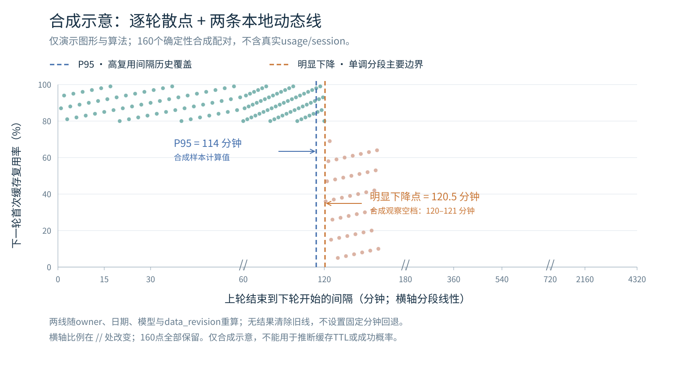

# 缓存间隔诊断：本地动态 P95 与明显下降点（接入规范）

> 当前设计入口：**方案口径 v7，2026-10-14 动态本地修订；2026-10-15 入库。**
> 状态：**设计交接，尚未完成生产接入。** 本次仅新增/更新文档与合成示意，不修改产品代码、用户数据库或安装包。
> 后续实现请以本文的逐轮采样合同、两线算法与状态规则为准。旧柱状/分桶图、固定分钟参考线、P90/P95 并列选择、P99 探索和条件风险交点均保留为历史，不是当前主界面或失败回退。

## 0. 接手先读

1. 本文是可直接读取的完整 Markdown 规范，不依赖私有云盘、聊天附件或另一执行环境的文件路径。
2. [单图两线合成示意](assets/cache-retention-dynamic-synthetic.svg)展示最终图形类型；图内数据全部按第 11 节确定性规则生成，**不是用户真实日志、产品截图或真实样本结果**。
3. 第 3–5 节定义数据合同，第 6–8 节定义算法、状态和缓存，第 9–12 节定义迁移、UI 与验收。附录 A 给出独立 sidecar 设计 DDL。
4. 实施者先核对当前目标分支完整 SHA、实际主库 schema/revision 和现有模块，再列改动清单。不要把本文件提交等同于功能已实现或已通过原生验收。



## 1. 最终产品选择

- 同一主图保留逐轮散点、**P95 历史高复用间隔覆盖线**、**明显下降点**及简短图例；不改成柱状图，不在主图堆计数表、会话排行或多个置信带。
- 两线在用户电脑上，使用当前 owner、日期范围、模型筛选和一致的 `data_revision` 计算。不得将任何演示分钟数设置为默认值、阈值或失败回退。
- 全部模型：池化当前同一用户/日期范围的合格原始配对，统一排序并拟合。**不能平均各模型的 P95 或下降点。**
- 单模型：先筛选原始配对，再独立重算两线。模型/日期/数据改变时，旧结果不能继续冒充当前答案。
- P95 表示历史高复用间隔的分布覆盖，不是 `P(高复用 | 间隔=t)=95%`，也不证明最优等待时间。
- 下降点是描述性分段边界，不是物理 TTL、最长保证或因果结论。允许只得到一条有效线，甚至两条均无结果；指标名称与状态仍保留。
- 诊断计算不得请求模型、发送保活或上传 usage。既有低命中提醒和计费统计分别保持原合同。

## 2. 现有源码证据与适配边界

交接前核到默认 `main` 为 `3e3f17c8e16d7a635431d1a4968692dad1a3cf8a`。该固定源码快照中的主索引 `schema_meta.schema_version=14`，不能据此推断每位用户的当前实库，也不能擅自把主库升级为 15。

相关现有入口：

- `Sources/CodexTokenBar/CodexUsageHistoryIndex.swift`
- `Sources/CodexTokenBar/CodexUsageAnalyzer+SessionParsing.swift`
- `Sources/CodexTokenBar/CodexUsageAnalyzerModels.swift`
- `Sources/CodexTokenBar/UsageEventLedger.swift`
- [既有低缓存提醒方案](../maintenance/2026-09-16-cache-hit-alert-performance-design.md)
- [压缩历史读取入口](../maintenance/compressed-history-read-entrypoints.md)

必须保留的区别：

1. 主 `events(source_id, source_offset)` 中的 `source_offset` 可为稳定 event ID，不能直接当文件 seek 位置。真实位置需要 generation 与读取层证据，必要时通过 `usage_ledger_bindings` 关联。
2. `dashboard_turn_candidates` 是每轮 latest input/cached 投影，不能当作本设计的 first usage。
3. 主 parser 的 emit 经过有效性、去重及计费变换；首条原始 usage 身份必须在这些过滤之前由旁路锁定。
4. `CacheUsageSample`、`UsageHistoryRetention`、SQLite driver 和当前诊断模块需在目标完整代码中逐一核查。本文不声称已经完成这些适配。
5. 新 sidecar 仅为可重建诊断状态，不是第二套消费账本。主账本成功而诊断落后时，只标诊断 pending。

## 3. 逐轮采样合同

### 3.1 统计单位和坐标

统计单位是同一 owner/source lineage/当前 generation 内的**完整相邻轮次**：

- x：上一轮 `task_complete` 到下一轮 `task_started` 的非负空闲间隔代理。
- y：下一轮最终用户 marker 后**第一条 usage**的 `last.cached_input_tokens / last.input_tokens`。
- 上一轮资格：取其轮末最后一条 usage。不是会话平均，不累加同轮流式 usage，不用累计 total 差分替代 last。

数据库时间统一为 UTC 整数微秒，并保留源时间精度标记。零间隔保持零，可能量化则标记，不加抖动。日期筛选按下一轮 `started_at` 的半开区间 `[start, end)`；上一轮可位于窗口外。用户时区先转换为 UTC 范围，并纳入 scope。

### 3.2 先锁第一条身份，再判断有效性

- 按解码后源顺序、ordinal 或逻辑 offset 锁定第一条，不按入库时间，也不选“第一条成功解析/有效”的 usage。
- 能识别为完整 usage 候选，即使缺 info、缺字段或数值非法，也锁定 identity，记录 `invalid/missing_fields`，排除整对；不得向后寻找第二条有效记录。
- 没有 usage：`unseen`。合法 `input>0, cached=0`：有效零。缺失不是零。
- `input=0`、负数、`cached>input`、小数、布尔值冒充整数或溢出：无效，保留原字段存在性和可保留的原值，不截断成有效比例。
- 半条 JSON 尾行等补全，不锁成无效首条。完整损坏行若无法判断事件类型，记 `evidence_incomplete`；可能遮蔽首条时排除该轮。
- 首条锁定后，后续流式 usage 不改变它；末条可随源顺序推进。
- 最终 marker 重归属、更正或身份变化必须增加 `turn_revision`，撤销受影响 pair 并重算，不能静默覆盖证据。

### 3.3 相邻性、资格与高低分类

先建立原始轮次顺序，再评估相邻配对。**不能先删坏轮，再把两侧好轮补连。**

`eligible_base=1` 要求：两轮完成、边界可靠、指定首末 usage 有效、模型已知且相同、时间非负。fork 继承、compaction、插入/并行、跨模型/缺模型、累计回落、非法时间、证据缺失等保留多值排除原因。开放轮次为 pending，不永久归为低复用。

主分析进一步要求上一轮末次 `cached/input >= 80%`。下轮首次 `cached/input >= 80%` 为高复用，否则为低复用，合法零包含在低复用中。80%定义事件类别；95%定义高复用间隔分布分位，不能互换。整数比较使用 checked arithmetic 或商余数法，避免任意 Int64 直接乘 5 溢出。

模型别名映射有显式版本；不能从路径猜模型。统计范围始终限制同一 owner，来源身份只能使用本地非敏感 key。

## 4. 独立诊断 sidecar 与字段

建议首次接入新建独立 SQLite sidecar，主计费/历史库只读。sidecar 自有 `schema_version=1`；这不表示主库版本。可执行设计 DDL 在附录 A，仅用于设计和合成验证，不能对主库运行。

| 表 | 字段职责 |
|---|---|
| `diag_meta` | schema、data、contract revision 与 clear_epoch |
| `diag_sources` | owner/session、当前 generation、parser revision、已提交解码逻辑 offset、边界 checkpoint、source revision、生命周期 |
| `diag_turns` | 原始顺序、最终 marker、模型、开始/完成、first/last identity、原始 token 字段及存在性/有效状态、turn revision |
| `diag_pairs` | 原始相邻 prev/next 引用及 revision、gap、next started、四个 token 投影、基础资格、80%派生标志、量化标记、published revision |
| `diag_pair_reasons` | 一个 pair 多个排除 reason；原因次数与独立样本数分别统计 |
| `diag_analysis_cache` | scope、输入 revision、算法版本、状态、n/k、P95、下降左右观察端点、分段、计算/访问时间 |
| `diag_notice_receipts` | scope/kind/result 幂等键；triggered/submitted/presented/dismissed 分开记，触发不等于已显示 |

turns 是观察事实，pairs 是可重建投影。四个 token 值及两个 turn revision 在同一事务、同一选定快照重建。高低 flag 仅为索引辅助；阈值改变须按原始整数重算并升级合同/算法版本。

raw_fields 仅保留必要 usage 数值与字段存在性，可限制 512 字节；不要存 prompt、完整回复、认证数据或个人路径。优先可信稳定 turn/request identity；缺失时使用 source+generation+原始 marker 身份/顺序构成本地 key，不能假称跨代稳定。压缩物理位置与解码逻辑 offset 分开。相同内容 fingerprint 不足以证明同一轮，不能套用旧 source 级集合做全局消重。

附录 DDL 是最小结构约束；它不能单独保证首条身份、时间顺序和 flag 与原始 token 的一致性。这些还必须由构建器、事务和测试验证。异常值超出 SQLite INTEGER 表达范围时，结构化列可为 NULL，并在受限 raw_fields/validity 中明确保留失败证据。

## 5. 索引、增量事务与幂等

- 全模型日期查询：`diag_pairs_time(next_started_at_us,pair_id)`，部分谓词 `eligible_base=1 AND prev_high_80=1`。
- 单模型日期查询：`diag_pairs_model_time(model_key,next_started_at_us,pair_id)`，同一谓词。
- 使用 keyset 分页；不以大 OFFSET 扫描。相邻查询用 `(source_key,generation,turn_ordinal,turn_id)`。
- pair 唯一身份包含 source/generation/previous_turn/next_turn/contract revision；FK 禁止跨 generation 引用。
- 查询 JOIN sources，限定 owner、`generation=current_generation`、active lifecycle 和当前 contract。未发布代际不得混入结果。

每次增量批次：

1. 解析完整行，锁定首条，更新末条及边界；诊断消费者不得阻断计费解析。
2. 单写者事务 UPSERT 受影响 turns，按原始邻接关系重建前后 pair 及全部原因。禁用会隐式删行的 REPLACE。
3. 同事务保存 checkpoint、source_revision 并递增 data_revision；全部成功才提交。相同 raw identity 重放为 no-op；内容冲突为 ambiguous。
4. 提交后只发一次变化信号。后台分析读一致快照，主线程不扫描或拟合。

两库无天然跨库原子性。sidecar 使用自己的 checkpoint 可重放恢复；锁冲突、磁盘满、损坏不能回抛中断主计费事务。主 events 的 ID/generation binding 只能是可缺失的辅助关系，关联失败不能删除或归零计费事件。

晚到/改写撤销受影响 pair，并重建两侧原始相邻关系。source删除、retention和clear_epoch进入checkpoint，避免清除后重扫复活。未知主库版本先停适配器，保留数据，不自动修复。

## 6. P95 的精确定义

对当前合格范围中，下轮高复用的 k 个原始 `gap_us` 升序排列 `t[1..k]`：

```text
r = ceil(0.95 * k) = (95*k + 99) // 100
P95 = t[r]                    # 上式为1-based，下标实现注意转换
coverage_count = count(gap_us <= P95)
```

最近秩，不插值，不按五分钟取整；整数算式防溢出。同值全部保留，coverage_count 可能大于 r。显示可约分钟，线的位置用原始值。

拟议可调显示门槛：

- k<20：`insufficient`，P95 为 null，显示“待估计”。
- 20<=k<100：描述性线，标“样本偏少”。
- k>=100：正常描述性线。

20/100 是待产品确认的显示参数，不是统计定律，须进入算法版本与scope。没有高复用点时不能取全部 gap 的 P95，也不能回填固定分钟。

## 7. 明显下降点：二项单调分段

### 7.1 拟合合同

全部高低配对按原始 gap 排序；同 gap 合并为 `(n_j,k_j)`，不拆 ties。候选段数 m=1、2、3；每段 n_s>=20，p_s=k_s/n_s，要求 `p_1 >= ... >= p_m`。

```text
L = sum(k_s*ln(p_s) + (n_s-k_s)*ln(1-p_s))
score(m) = -2*L + (2*m-1)*ln(N)
```

0*ln(0)按0；使用逐点Bernoulli似然，不加分段组合数。参数数为m个概率和m-1个切点。此BIC式惩罚是版本化研究规则，不是已校准的置信检验。

固定m按切点字典序遍历；仅当L比最佳高超过1e-12才替换，近似并列保留较早组合。评分距最小值<=1e-10时优先较少段。

- N<40，或没有能支持两段各>=20的候选位置：支持不足，drop=null。
- 有支持但最佳1段，包括没有可接受单调两段：未检出下降，drop=null。
- 最佳3段有两个下降界：主图只显示相邻段概率差最大者；同差选较早者，其余放详情。
- 切点只能在相邻不同观察gap之间。线位为两端空档中点；保留左右原值。这个空档不是置信区间。
- 微秒中点按不会溢出的实现计算；如需半微秒线位，可保存左右端点并在显示层求中点，不能先相加导致溢出。

### 7.2 有界候选与复杂度

拟议单scope N<=100,000、候选边界B<=512。N超限时**两指标同时**返回 `range_too_large/null`、清除旧线、提示缩小日期；不抽部分样本冒充全范围。

G个不同gap排序分组，建立累计样本N[j]与高复用K[j]。G-1<=512时枚举所有边界，精确搜索；否则对 i=1..B：

```text
j = clamp(lower_bound(cumulative_N, i*N/(B+1)), 1, G-1)
candidates = sorted(unique(j))
search_mode = bounded_candidate_grid
```

前缀计数令每段n/k/L为O(1)；一界O(B)、两界O(B²)。单次拟合O(N log N+B²)、工作内存O(N+B)；不创建G×G矩阵，不每刷新全量平方扫描。大样本候选网格是有界近似，不声称全候选全局最优。P95仍精确排序O(k log k)，不改成近似分位。

### 7.3 来源敏感性

至少3个独立来源时逐一删来源重算，检查段数与主要边界一致性；可调位置容差为max(5分钟,全样本边界×20%)。这是敏感性标记，不是统计置信。

不足3来源：来源不足；不一致：不稳定；来源>20或预算超限：未完成，不能伪报通过。首次可先发布描述性拟合并标检查pending，后台可取消阶段完成后按同一版本补状态。拟议5秒软预算需目标机实测，不是性能保证。

## 8. 状态、缓存与发布

建议按指标保存独立状态，overall state只作总览，不能用一个ready掩盖另一指标无结果：

| 条件 | P95 | 下降点 | 必须行为 |
|---|---|---|---|
| 当前scope有效结果 | 本次计算值 | 本次计算值或未检出 | 标owner/scope/revision一致 |
| k<20/无高复用 | null/待估计 | 按全部点独立求解 | 清除旧P95 |
| N<40/无可支持切点 | P95仍按规则求解 | null/待估计 | 清除旧下降线 |
| 最佳1段 | P95按规则求解 | null/未检出 | 不为凑两线设置时间 |
| N超限 | null | null | 提示缩小范围 |
| 筛选/owner变化 | pending/null | pending/null | 旧scope结果不能作为当前线 |
| 失败/数据过期 | 当前无新结果 | 当前无新结果 | 可单独保留最后成功版本并明显标旧，不混入当前图 |
| 来源不足/不稳 | 描述性结果 | 描述性结果＋状态 | 不升级为保证或自动推荐 |

只有配对批次提交、筛选或算法参数改变才置脏。数据事件可250ms合并；最多一个当前分析作业，旧作业可取消。无变化不定时重算；打开页面可直接读有效缓存。完成时比对当前scope和输入revision，过期结果不得发布。

scope_hash包含owner、UTC日期范围/时区、全模型或模型key、模型映射版本、资格合同、80%类别阈值、P95定义及显示门槛、分段参数、候选网格、算法/合同版本。缓存另存input_revision和来源构成。首版可保守使用全局revision失效，只算当前可见scope；最多20个scope，LRU只删可重算结果。数据更正/删除/清除必须失效缓存。

## 9. 迁移、回填、回退

1. 实施前记录目标完整SHA、未提交改动、构建号，按授权只读核主库schema_meta、sqlite_master、table/index/FK及ledger/representation revision。读取路径不能暗中触发主库迁移。
2. 新sidecar先在候选文件创建并验证DDL/外键/版本，成功后原子发布。文件目录与owner接法在完整仓库适配时确认。
3. sidecar升级前使用SQLite在线backup，或受控关闭/WAL协调后备份；禁止复制活跃.db而漏WAL。记录版本/校验和/恢复入口，实际验证可打开。
4. 遇到未来sidecar版本停止写入并显示不可用；旧app通过feature flag忽略它。回退先关闭诊断观察者/UI，不回滚用户新产生的计费。
5. 回填使用当前受支持的普通/压缩reader和原始完整记录，不能从events/dashboard反推首条。读取不足记范围缺失，不创造样本。
6. 建议每批最多500轮或50ms，保存最后完整行checkpoint与边界状态，提交后让出。后台预算须目标机实测。
7. 每来源用shadow generation回填；chunk/身份校验完成才单事务切换current_generation和revision。失败保持旧已验证代际并标更新中，不混代。
8. 截断、替换、重压缩先验证逻辑内容，不能仅凭size/mtime续读；删除、保留与清除epoch参与恢复。
9. 历史回填不逐条触发现有低复用提醒；完成时最多一次分析可用提示并保存真实展示receipt。
10. 磁盘满/锁/损坏停止诊断发布，主计费继续。拟议500MiB软预算超出先暂停回填；自动删除期限、备份数和清除交互待确认，不随本文执行删除。

## 10. 主图、提醒与计费隔离

- 散点保留原始值，无抖动、无抽样。长尾不截断。可分批/分页加载完整所选点，不能让未加载点参与“已完整展示”声明。
- 单张主图横轴采用全长分段线性：边界0/60/180/720/4320分钟，对应相对显示位置0/32/60/85/100；各段内部线性，接缝明确标“//”。它不是全轴等比例，也不能说成对数轴。
- 超过4320分钟时扩展末段并显示真实刻度，不能夹在边缘。线位用与点相同的变换函数。
- 全模型/单模型与日期控件放图外。悬停再看模型、时间、token原值；主图不放会话排行或计数表。
- 图例：“P95（当前样本计算值）”“明显下降点（当前样本计算值）”；底注：“按当前用户与筛选数据计算，不保证缓存”。
- 可选经验提示里的分钟占位符只能来自当前有效结果；P95仍是历史覆盖，下降仍是描述性分段。
- 既有<30%/输入量20,000等低命中提示条件须核现实现，不可被本分析的80%类别阈值替换。新分析可用提示的冷却/显著变化等另行确认，仅应用内提示。
- 计费归零/恢复/去重修复单独复现和验收。诊断不写消费events、不修金额，不能用无条件max(previous)掩盖真实新epoch消费。

## 11. 公开可复算合成示意

这里只给不含个人数据的确定性测试向量，图中分钟数没有产品建议含义。

```python
# 160个合成相邻配对，i=1..160；所有上一轮均 input=1000,cached=900。
rows = []
for i in range(1, 161):
    ratio_percent = 80 + (i * 7 % 20) if i <= 120 else 5 + (i * 11 % 65)
    rows.append({
        "gap_us": i * 60 * 1_000_000,
        "next_input": 1000,
        "next_cached": ratio_percent * 10,
        "model_key": "synthetic-A" if i % 2 else "synthetic-B",
    })
```

按本文算法：

| 范围 | n / k | P95 | 主要下降观察空档与中点 |
|---|---|---|---|
| 全部模型 | 160 / 120 | 第114个高点，114分钟 | 120–121分钟；120.5分钟 |
| synthetic-A | 80 / 60 | 第57个高点，113分钟，样本偏少 | 119–121分钟；120分钟 |
| synthetic-B | 80 / 60 | 第57个高点，114分钟，样本偏少 | 120–122分钟；121分钟 |

全模型最优2段；1/2/3段评分约185.0224200933 / 15.2255214457 / 25.3758690762。将全部gap乘2，P95和下降中点也必须乘2；空集必须清线。合成模型分组仅测试筛选，不能用于比较真实模型或证明缓存行为。图中只有合成点，不包含真实usage/session、DM、个人路径或私有附件。

## 12. 验收与未实现边界

| 测试组 | 必须覆盖 |
|---|---|
| 首条与资格 | 首条invalid不能换后条；unseen不等于零；半JSON等待；marker重归属；流式末条；fork/并行/compaction/回落/缺模型排除；不跨坏轮补连 |
| 身份与恢复 | 重复扫描/重启不增点；event ID不作seek；单已发布generation；原子checkpoint；崩溃/磁盘满不影响原计费 |
| P95 | nearest-rank、ties、空集、全高/全低、k=19/20/99/100、防溢出 |
| 下降 | N=39/40、同gap、无支持切点、1段胜出、3段最大下降选择、同分规则、有界候选及超限 |
| 范围与缓存 | 窗口首对、时区边界、单模型重算、全模型池化、owner隔离、旧作业不能覆盖新scope、删除后重算 |
| 动态UI | 改gap两线变；空集/失败清旧线；状态不消失；长尾扩轴；无抽样/抖动；真实展示receipt |
| 迁移兼容 | 备份可恢复、未来schema拒写、中断续传、清除不复活、旧app忽略sidecar、主计费行数/金额/指纹不变 |
| 目标机性能 | 1千/1万/10万/超限；冷/热缓存、追加/更正、来源留一、压缩回填、快速切换；p50/p95、主线程卡顿、RSS、DB/WAL增长 |

已有离线设计验证不能替代以下NOT RUN：Swift/Rust生产实现、真实主库/sidecar迁移、完整模块兼容、Mac/Windows目标机性能、安装升级与用户现场验收。本次仓库提交仅使规范可见，不宣称这些已完成。

接手者回报：准确branch与完整SHA；实际修改文件；每组PASS/FAIL/NOT RUN及证据；未解决边界；备份、迁移、回退步骤；有无触碰主计费路径。

## 13. 历史方案的使用规则

- 旧柱状图/固定时间分桶：只作历史观察或排查；不能替代当前逐轮散点。
- 固定分钟参考线：不是当前算法；不能作为缺数据/失败时的回退。
- P90/P95并列选择、P99探索：只保留历史讨论，当前P95是覆盖线，另一条是主要下降。
- 条件风险交点和三线预览：不作为当前默认主图。
- 既有低命中提醒文档继续描述该提醒功能；其中性能p95/p99也不是本文的高复用间隔P95。
- 历史release/交接文档不删除。发生口径冲突时，仅本项缓存间隔诊断以本文为准；不据此改变其他产品合同。

## 附录 A：独立 sidecar 设计 DDL

**只在新建的独立诊断库执行。严禁对计费/历史主库执行。** 下述schema_version=1属于诊断命名空间。存储结构之外仍须实现正文合同、事务和验收。

```sql
-- DESIGN ONLY: standalone diagnostics database; never run on the billing/history DB.
-- schema_version=1 below belongs to this NEW namespace, not TokenBar main schema.
PRAGMA foreign_keys=ON;
CREATE TABLE diag_meta(key TEXT PRIMARY KEY,value TEXT NOT NULL) WITHOUT ROWID;
INSERT INTO diag_meta VALUES('schema_version','1'),('data_revision','0'),('contract_revision','adjacent-turn-first-usage-v1'),('clear_epoch','0');
CREATE TABLE diag_sources(
 source_key TEXT PRIMARY KEY,owner_key TEXT NOT NULL,session_key TEXT NOT NULL,
 current_generation TEXT NOT NULL,parser_revision TEXT NOT NULL,
 committed_offset INTEGER NOT NULL DEFAULT 0 CHECK(committed_offset>=0),
 checkpoint_json TEXT NOT NULL DEFAULT '{}',
 source_revision INTEGER NOT NULL DEFAULT 0 CHECK(source_revision>=0),
 lifecycle TEXT NOT NULL CHECK(lifecycle IN('active','missing','rewritten','deleted','blocked')),
 updated_at_us INTEGER NOT NULL
) WITHOUT ROWID;
CREATE INDEX diag_sources_owner_session ON diag_sources(owner_key,session_key);
CREATE TABLE diag_turns(
 turn_id INTEGER PRIMARY KEY,source_key TEXT NOT NULL REFERENCES diag_sources(source_key),
 generation TEXT NOT NULL,turn_key TEXT NOT NULL,turn_ordinal INTEGER NOT NULL CHECK(turn_ordinal>=0),
 final_marker_key TEXT NOT NULL,final_marker_ordinal INTEGER NOT NULL,model_key TEXT,
 started_at_us INTEGER,completed_at_us INTEGER,
 first_usage_key TEXT,first_raw_offset INTEGER,first_event_at_us INTEGER,
 first_input INTEGER,first_cached INTEGER,first_raw_fields TEXT,
 first_state TEXT NOT NULL CHECK(first_state IN('unseen','valid','invalid','missing_fields')),
 last_usage_key TEXT,last_raw_offset INTEGER,last_event_at_us INTEGER,
 last_input INTEGER,last_cached INTEGER,last_raw_fields TEXT,
 last_state TEXT NOT NULL CHECK(last_state IN('unseen','valid','invalid','missing_fields')),
 boundary_state TEXT NOT NULL CHECK(boundary_state IN('open','complete','ambiguous','excluded')),
 turn_revision INTEGER NOT NULL DEFAULT 1 CHECK(turn_revision>=1),
 UNIQUE(source_key,generation,turn_key),UNIQUE(turn_id,source_key,generation),
 CHECK(first_state='unseen' OR first_usage_key IS NOT NULL),
 CHECK(last_state='unseen' OR last_usage_key IS NOT NULL),
 CHECK(first_state<>'valid' OR (first_input IS NOT NULL AND first_input>0 AND first_cached IS NOT NULL AND first_cached>=0 AND first_cached<=first_input)),
 CHECK(last_state<>'valid' OR (last_input IS NOT NULL AND last_input>0 AND last_cached IS NOT NULL AND last_cached>=0 AND last_cached<=last_input))
);
CREATE INDEX diag_turns_adjacency ON diag_turns(source_key,generation,turn_ordinal,turn_id);
CREATE TABLE diag_pairs(
 pair_id INTEGER PRIMARY KEY,source_key TEXT NOT NULL,generation TEXT NOT NULL,
 previous_turn_id INTEGER NOT NULL,next_turn_id INTEGER NOT NULL,
 previous_turn_revision INTEGER NOT NULL,next_turn_revision INTEGER NOT NULL,
 contract_revision TEXT NOT NULL,model_key TEXT,next_started_at_us INTEGER,gap_us INTEGER,
 previous_input INTEGER,previous_cached INTEGER,next_input INTEGER,next_cached INTEGER,
 eligible_base INTEGER NOT NULL CHECK(eligible_base IN(0,1)),
 prev_high_80 INTEGER NOT NULL CHECK(prev_high_80 IN(0,1)),
 next_high_80 INTEGER NOT NULL CHECK(next_high_80 IN(0,1)),
 time_quantized INTEGER NOT NULL DEFAULT 0 CHECK(time_quantized IN(0,1)),
 published_revision INTEGER NOT NULL CHECK(published_revision>=0),
 UNIQUE(source_key,generation,previous_turn_id,next_turn_id,contract_revision),
 FOREIGN KEY(previous_turn_id,source_key,generation) REFERENCES diag_turns(turn_id,source_key,generation),
 FOREIGN KEY(next_turn_id,source_key,generation) REFERENCES diag_turns(turn_id,source_key,generation),
 CHECK(previous_turn_id<>next_turn_id),
 CHECK(eligible_base=0 OR (gap_us IS NOT NULL AND gap_us>=0 AND next_started_at_us IS NOT NULL AND model_key IS NOT NULL AND previous_input IS NOT NULL AND previous_input>0 AND previous_cached IS NOT NULL AND previous_cached BETWEEN 0 AND previous_input AND next_input IS NOT NULL AND next_input>0 AND next_cached IS NOT NULL AND next_cached BETWEEN 0 AND next_input))
);
CREATE INDEX diag_pairs_time ON diag_pairs(next_started_at_us,pair_id) WHERE eligible_base=1 AND prev_high_80=1;
CREATE INDEX diag_pairs_model_time ON diag_pairs(model_key,next_started_at_us,pair_id) WHERE eligible_base=1 AND prev_high_80=1;
CREATE INDEX diag_pairs_source_generation ON diag_pairs(source_key,generation,pair_id);
CREATE INDEX diag_pairs_previous_turn ON diag_pairs(previous_turn_id);
CREATE INDEX diag_pairs_next_turn ON diag_pairs(next_turn_id);
CREATE TABLE diag_pair_reasons(
 pair_id INTEGER NOT NULL REFERENCES diag_pairs(pair_id) ON DELETE CASCADE,
 reason_code TEXT NOT NULL,detail_code TEXT,
 PRIMARY KEY(pair_id,reason_code)
) WITHOUT ROWID;
CREATE TABLE diag_analysis_cache(
 scope_hash TEXT PRIMARY KEY,scope_json TEXT NOT NULL,algorithm_version TEXT NOT NULL,
 input_revision INTEGER NOT NULL,state TEXT NOT NULL CHECK(state IN('ready','insufficient','unstable','pending','failed','range_too_large')),
 n INTEGER NOT NULL CHECK(n>=0),high_n INTEGER NOT NULL CHECK(high_n BETWEEN 0 AND n),
 p95_gap_us INTEGER,drop_left_us INTEGER,drop_right_us INTEGER,
 result_json TEXT NOT NULL,computed_at_us INTEGER NOT NULL,last_accessed_at_us INTEGER NOT NULL,
 CHECK(p95_gap_us IS NULL OR p95_gap_us>=0),
 CHECK((drop_left_us IS NULL AND drop_right_us IS NULL) OR (drop_left_us IS NOT NULL AND drop_right_us IS NOT NULL AND drop_left_us<drop_right_us))
) WITHOUT ROWID;
CREATE INDEX diag_analysis_cache_lru ON diag_analysis_cache(last_accessed_at_us);
CREATE TABLE diag_notice_receipts(
 scope_hash TEXT NOT NULL,kind TEXT NOT NULL,result_hash TEXT NOT NULL,
 triggered_at_us INTEGER NOT NULL,submitted_at_us INTEGER,presented_at_us INTEGER,dismissed_at_us INTEGER,
 PRIMARY KEY(scope_hash,kind,result_hash)
) WITHOUT ROWID;
```
