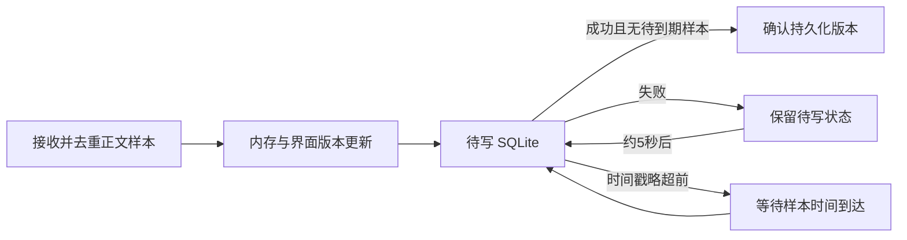

# 全量审查修复说明（2026-10-23）

本次修复对应同日全量审查的 F01–F11。目标是保护账本和恢复证据、让取消真正阻止后续请求、保证样本写入可重试，并减少隐藏窗口和重复绘制产生的开销。

源码起点：`5d09ea082d82e9935533e7642cb89c40371b7037`。修复分支：`codex/whole-app-audit-fixes-20261023`。

这是源码及本地验证记录。本次没有替换 `/Applications/Codex Token Bar.app`，没有推送、发布或进行真实模型检测/续跑。测试中的模型请求均为假服务。Windows 的既有安装及历史验收不代表本修复已在 Windows 上运行。

## 修了什么

| 编号 | 原因与影响 | 现在的行为 | 主要代码入口 |
|---|---|---|---|
| F01 | 修复失败后恢复整份数据库，可能覆盖期间出现的外部写入 | 自动补偿必须检查运行状态和修改归属；无法证明归属时保留恢复点和 journal，交给显式恢复 | Swift `ProviderSyncEngine+SafeRepair/SQLiteRepair/Migration.swift`；Rust `core/provider_repair.rs`、`backups.rs` |
| F02 | 取消检查与发送请求之间有时间窗口 | 取消与 `turn/start`、肯定批准响应使用同一同步门；已发出的轮次仍走 interrupt/清理流程 | Swift `CodexAutoResumeAppServerClient.swift`、`AutoResumeController.swift`；Rust `core/auto_resume.rs`、`commands/auto_resume.rs` |
| F03 | 去重/内存接收被误当成持久化确认；失败后没有新样本就不再写 | 界面版本、待写版本、成功写入版本分离；写盘失败约 5 秒后重试；未来样本到时再写 | Swift `LiveRateMonitor.swift`、`ThroughputTelemetry.swift`；Rust `core/live_rate/observed.rs` |
| F04 | 孤儿记录校验前先执行 schema DDL | 对需要显式孤儿修复的已有索引先只读检查，拒绝时不改变主库字节 | Rust `core/usage/token_count_jsonl/exact_usage_index.rs` |
| F05 | 主 sessions 目录缺失被当成成功扫描了 0 文件 | 主目录缺失则扫描失败，旧账本和覆盖证明保留；已有空目录和缺失可选 archive 仍可处理 | Swift `CodexUsageAnalyzer+SessionParsing.swift` |
| F06 | 原生详情隐藏，却没有通知 React，定时查询继续运行 | 收起时只发一次空 presentation，卸载详情子树；页面隐藏时停止趋势/ModelTrace UI 定时器，重新可见再读取 | `quota-sidebar/presentation.ts`、`QuotaSidebarApp.tsx`、`useDocumentVisible.ts` |
| F07 | 设置广播没有更新侧栏 quota cadence | 广播同步刷新间隔、显示设置和量程，并使旧启动读取失效 | `QuotaSidebarApp.tsx` |
| F08 | 实时父组件更新重复过滤、排序并绘制整个趋势 SVG | 数据源按值比较，图表 memo；数据派生使用 useMemo，仅输入、选项或可见性变化时更新 | `components/liveRate/BodySpeedTrend.tsx` |
| F09 | Rust 每秒重新扫描全部保留历史，计算 5/15/30 分钟等摘要 | 样本改变、窗口边界到期或系统时钟回退才重算；保留原有统计窗口及历史 | Rust `core/live_rate/observed.rs` |
| F10 | Rust 跳过全部 subagent；Swift 漏掉 item 内时间戳 | 纳入子任务自身新正文，继续排除继承历史；两端支持 payload/item 时间戳布局 | Swift `CompletedBodySpeed.swift`；Rust `core/live_rate/completed_body.rs` |
| F11 | Swift app-server 子进程继承 Node/Electron 注入变量和签名变量 | 共用 transport 始终过滤四项变量，保留 HOME/PATH/代理及正确 CODEX_HOME | Swift `AccountQuotaReader.swift` |

## 恢复与取消为什么这样实现

### Provider 自动补偿只撤销能证明属于自己的修改

Swift 自动补偿读取恢复点中的原 Provider 值，在 `BEGIN IMMEDIATE` 内检查现值。现值只能是原值或本次目标值；如果是第三方的新值，就整笔回滚补偿事务并报错。真正写回的只有 `model_provider`，新增行、其他列和其他表保留。迁移的会话首行也必须是原首行或本次生成的目标首行，正文尾部仍按已有机制保留。

Rust 旧的 Prepared mutation journal 只有恢复前快照，没有可证明归属的完整写入集合。因此不再自动用旧快照覆盖全库。自动恢复会说明延期原因并保留证据；用户选择该 journal 对应的恢复点后，才能走显式恢复。普通 restore transaction 的补偿增加成员现值检查、存储身份检查及真实运行状态探针。

命令入口也区分这两种路径：普通修改仍受待恢复状态阻止；只有当前 Home 下、错误码与 journal 一致的显式回滚可继续进入核心校验。核心再次验证选中的备份、账号、存储身份和运行状态，并先保留当前状态恢复点。完成后刷新恢复状态，避免界面继续显示旧的阻止状态。

显式恢复失败后也不能继续盲目覆盖整库。恢复前证据必须保留；成功验证前不能清除待恢复 journal。看到恢复延期时，先退出 Codex，检查界面给出的恢复点，选择对应备份执行恢复。不要手工删除 journal 来消除提示。

### 取消有明确的发送边界

发送新轮次或肯定批准响应时，先进入与取消共用的锁。取消获得该锁后标记失效，后续发送就会被拒绝。已经先获得锁并发出的请求无法被撤回；仍需等待 turn ID、发 interrupt，再结束进程。Swift 在该过程完成前保留本地执行占用，避免第二轮与上一轮清理重叠。

### 持久化确认与界面展示分开



读取器去重不再阻止重试；同一样本 ID 的重复写入仍然幂等。数据源切换会使旧写入完成回调失效。未获 SQLite 成功确认的样本仍在内存中，不能称为已持久保存；程序崩溃前尚未落盘的数据没有新增的跨进程持久队列保证。

## 前端冗余和加载范围

已删除以下 5 个没有生产导入入口的旧模块，共 805 行生产代码：

- `components/liveRate/LiveRateSettingsPanel.tsx`
- `components/liveRate/calloutPlacement.ts`
- `components/liveRate/observedSpeedPresentation.ts`
- `components/liveRate/observedSpeedWindow.ts`
- `status/StatusQuotaProjection.tsx`

同时移除仅服务这些旧模块的专属测试，保留当前功能的测试；修正了仍读取旧面板源码的测试。没有按文件长度批量删除 CSS，也没有因为少数选择器重复就改变层叠优先级。

`app/App.tsx` 现在按窗口类型懒加载主面板、侧栏、悬浮窗、状态窗和引导层。初始入口 JavaScript 从约 960.09 KB（gzip 284.31 KB）变为约 250.48 KB（gzip 78.39 KB）。其余页面及共享逻辑进入独立 chunk；这不表示整个应用总下载量同比减少。公共 CSS 仍保留，进一步按 surface 拆分需要单独做视觉验收。

## 性能证据如何理解

同一 864 点 Happy DOM/React 开发模式夹具，20 次数据不变的父组件更新：修复前累计约 198.66 ms，修复后约 0.098 ms。外层 Profiler 仍记录 20 次提交，内部图表通过 memo 复用；因此没有把提交次数误报为 0。隐藏趋势读取从 1 次降为 0，隐藏后没有 60 秒定时器。

这些数字证明该重复工作路径已消除，不是整机 CPU 降幅、实际 WebView 帧率或已安装软件体验的承诺。原生受控性能测试和最终回归结果见本次验证记录。

## 回归与复验

测试结果与日志目录：项目外层 `runs/20261023-whole-app-audit-fixes/`，总表为其中 `REPORT.md` 和 `verification.json`。

最终结果：Swift 1,880 项（18 跳过）、Rust 本机 lib 1,374 项（11 ignored）、前端 1,234 项、脚本 103 项（1 跳过），均为 0 失败；TypeScript/Vite 生产构建通过。两项可选原生性能夹具另行通过。原生可见速度页刷新 p95 为 2.48 ms，但主循环最大间隔仍达 79.25 ms，不能将夹具通过等同于所有卡顿已经消除。

本次补充/修复的关键测试包括：

- 外部新增行和其他字段在自动补偿后仍保留；冲突字段、运行状态不明或运行中时拒绝补偿；对应的显式恢复入口仍可使用。
- 假 app-server 在取消后送来批准请求，不能得到肯定批准；同一发送门取消后不能发送新轮次。
- 写盘失败恢复后无需新样本即可重试；未来样本到期后只形成一份样本/趋势贡献。
- 孤儿索引被拒绝打开时主数据库字节不变；主 sessions 目录消失时旧账本/覆盖证明不变。
- 隐藏/重新显示停止和恢复 UI 读取；等值 source token 不重建趋势图；设置广播更新 cadence。
- 统计摘要在临界点、样本入窗/出窗和时钟回退时更新，普通空闲 tick 复用缓存。
- 子任务自己的正文被纳入，继承历史被排除；嵌套时序字段和环境变量过滤有独立夹具。

子任务归属证据不足时不计入测速：普通 fork 需要创建时间或子轮次 UUID 的证据；分页历史可以使用本任务起始 ordinal。不能因为缺少创建时间就把继承正文当成新样本。

从源码根目录复验：

```sh
swift test --jobs 2
cargo test --locked --offline --jobs 2 --manifest-path tauri-app/src-tauri/Cargo.toml --lib -- --test-threads=1
```

前端在 `tauri-app/` 执行 `npm run build`。测试文件通过 `rg --files` 收集全部 `*.test.mjs` 后传给 `node --test`，分别覆盖 `tauri-app/src/` 和 `scripts/`（包括子目录）。构建/测试应串行运行以控制磁盘和内存占用。原生性能夹具需显式设置 `CODEX_SIDEBAR_RATE_PERF_OUTPUT` 与 `CODEX_SIDEBAR_PERF_OUTPUT`，再运行 `swift test --skip-build --filter SidebarTransitionPerformanceTests`；普通全量回归默认跳过这两项。

审查阶段已有的 6 个陈旧断言也已更新：Swift frame spy、schema 版本、5 秒曲线边界、显示单位表达式，以及前端关闭状态下的单位选择器和格式化入口。全量复测另发现一个并发夹具竞态：两个文件可并行解析，原测试未等第一文件解析完就追加数据。已加入解析完成屏障，保留原有 180→290 及缓存命中断言，没有放宽预期数字。

## 后续维护和回退

本次没有拆解两端的大型账本核心文件。对这类文件，拆分必须保持事务、账本归属、缓存失效和覆盖证明的完整边界；纯按行数拆文件不会改善正确性。建议后续将持久化调度、统计窗口调度与平台 UI 逐步保持独立，并继续用当前回归夹具防止重新耦合。

源码回退使用本修复提交的 `git revert`，不要回退用户账本或删除历史样本。验证运行目录包含日志和合成夹具，可与源码提交一起追溯；已有安装和数据未由本任务改写。
