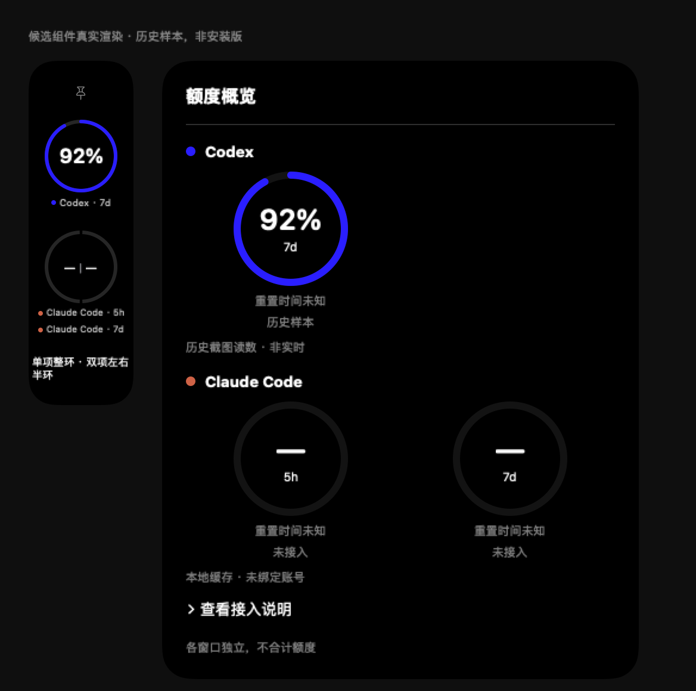

# 多客户端原界面整合：实现与验证

2026-10-25 · 分支 `codex/multi-client-tokens` · 基线 `6698295a`

工作目录：`/Users/huyiyang/.codex/worktrees/multi-client-tokens/codex-token-dashboard`。

## 用户刚补充的额度规则

- Codex PRO 实际只有7天窗口：一个完整360°圆环，不画不存在的5小时半圈。
- Claude有5小时和7天两个窗口：同一个完整圆形轮廓左右各半，各自表达自身0–100%。没有本地缓存时两侧显示—，不编造读数。
- 默认按客户端分组，单项整环、双项左右半环；用户隐藏一项后剩余项自动占整环。跨客户端左右配对保留为主动设置，默认关闭。
- 一级每项始终一根完整竖条，独立品牌圆点；所有已选项目都保留。长条/短条/自动持久化，完整长条总高超原基线25%切短，最终受当前显示器工作区限制；隐藏后按实际内容缩小外框。
- 三级每个窗口独立完整圆环，显示窗口、重置时间、来源、未知/旧数据状态与本地接入说明。

## 其他实现

原界面左上角只有一个持久化范围：Codex / 已启用或有历史的客户端 / 汇总。默认Codex；切换同时作用于原位置的Token、模型费用、活动、趋势、额度与缓存显示，移除此前独立大用量卡。新客户端仍通过本地发现轻提示启用，禁用不删旧账。模型身份颜色与客户端品牌圆点分开。

趋势从原始事件直接聚合5分钟UTC桶，24小时/7天/30天分别显示5分钟/小时/6小时桶，包含边缘未满桶；活动图另按本地日历聚合365天，已覆盖跨时区和夏令时。不可从小时总量均摊伪造5分钟数据。

新增客户端API等值按单次请求选择阶梯、分别计价再相加，使用随代码固定的离线价目表。准确模型/别名才匹配；时间规则、无法确定的缓存写入寿命、未知模型或异常溢出不计价并计入未计价请求数。真实免费、未知和小于1美分分别表示。Codex费用沿用现有价格与账本，不重写历史。

缓存率按可比较输入加权；某请求缺失缓存读数字段时，其输入不参与分母，避免未知变成零命中。其他客户端没有可靠整轮归属时不编造单轮排行榜；Codex明细仍可打开。

## 数据、性能与兼容

- 沿用独立 `multi-client-usage.sqlite` 的v2原始事件/断点/修订结构，新增字段是快照投影。此次不升级schema、不迁移或改写Codex原始账本，也未打开正式数据库执行迁移。已有账本备份入口保留。
- 每个价格摘要和数值汇总在同一SQLite读事务内，防止并发写入造成价格和Token版本不一致；快照提交后才发布缓存。
- 计价缓存按账本revision失效；趋势/活动聚合按revision、分钟与本地日历/时区边界失效。不因TPS每秒刷新重算历史，不为额度圆环增加网络请求或独立定时器。
- Swift原生和React/Tauri对应投影、未知状态及布局规则同步；Rust原生侧栏新增可选 `compactHeight`，旧调用不传时保留旧几何默认值，拖动/吸附/多屏布局沿用原状态机。
- Agent Speed基线已在父提交 `2d94a34e` 合入（`63cba542`）。本次未改Vendor/AgentSpeed及现有上报控制器/界面，只读引用已固定价目资产。合回测速分支时保留其采样与默认关闭设置，本分支的新增UI通过来源范围接入；如同改Dashboard/侧栏文件，按两条测速口径分开处理。

## 覆盖边界

其他客户端尚未接入原正文TPS计时数据：显示未提供；汇总的正文TPS/雷达明确标Codex覆盖，不拿Agent Speed值顶替正文TPS。非Codex活动图仅显示Token统计，不假造额度历史或不同订阅周期的合计费用。

Claude只读已有本地缓存 `~/.claude-monitor/statusline/latest.json`，显示账号未绑定及缓存有效状态；没有自动安装/修改statusLine，没有读取凭据，没有向Anthropic发送请求。联网额度仍未实现，保持关闭，需要另行确认方案。

## 验证

| 检查 | 结果 | 范围 |
|---|---|---|
| Swift全量XCTest | PASS：1,941项，21项跳过，0失败 | 原生源码/账本/布局；跳过项不算运行验收 |
| Agent Speed Swift Testing | PASS：647项，76套件 | 既有测速核心回归 |
| Rust `cargo test --lib -- --test-threads=1` | PASS：1,395通过，11忽略，0失败 | macOS主机上的共享Rust核心；非Windows EXE运行 |
| UI `node --test` | PASS：1,252项，0失败 | 模型投影、React交互/渲染契约及既有回归 |
| TypeScript/Vite `npm run build` | PASS | 类型检查及前端资源构建；不是安装包 |
| `git diff --check` | PASS | 空白/补丁检查 |
| 正式Mac / Windows EXE运行 | NOT_RUN | 未获本分支安装授权，未替换或重启 |
| 原生实时动画 | NEEDS_LIVE_VALIDATION | 当前测试进程无display-link回调 |

日志位于本worktree的 `scratch/integrated-*-release-check.log`，不纳入源码。Swift跳过的21项中20项为原有可选/环境门槛，1项为下述屏幕刷新回调检查。

实时动画测试发现当前命令行测试进程的 `NSScreen.displayLink` 不能交付回调：独立AppKit探针1秒收到0次。现有动画测试原来因此产生两处失败断言；现改为先用独立探针检查运行能力，无回调时明确跳过，不更改生产动画/降低断言。裁剪、几何、工作区、窗口整环/半环规则仍正常测试。该项需要候选应用实机验证，不能以跳过当成动画验收通过。

另将Rust原有1毫秒缓存新鲜度边界测试改为注入固定 `Instant`，保留原边界断言，避免调度延迟导致假失败；生产仍取当前时钟，缓存策略不变。

## 文件与预览

- `IntegratedClientPresentation.swift` / `IntegratedClientViews.swift`：原生范围、额度设置/整半环、竖条布局、原位置模块。
- `ScopedClientCacheView.swift`：可比较缓存覆盖投影。
- `MultiClientUsageLedger.swift` / `MultiClientUsageStore.swift`：计价/时间桶/快照缓存。
- `QuotaSidebarViews.swift` / `QuotaSidebarController.swift` / `QuotaSidebarGeometry.swift`：三级来源接入与内容高度。
- `tauri-app/src/multiClient/`：对应范围状态、纯投影、组件、CSS及测试。
- `tauri-app/src-tauri/src/core/multi_client_usage.rs`：Windows共享账本聚合/计价；`platform/quota_sidebar*`接收动态高度。
- Dashboard、TokenActivity、Settings及对应回归测试同步接线。

设计：[方案](../design/2026-10-25-integrated-clients/方案.md)。

图为实际候选组件离屏渲染；92%来自此前真实历史截图，并非当前额度。Claude未接入显示—。不代表整软件安装或实时数据验收。

未安装、替换或重启正式Mac应用，未构建/替换Windows EXE；正式机拖动、多屏、整页交互及功耗实测仍未进行。
