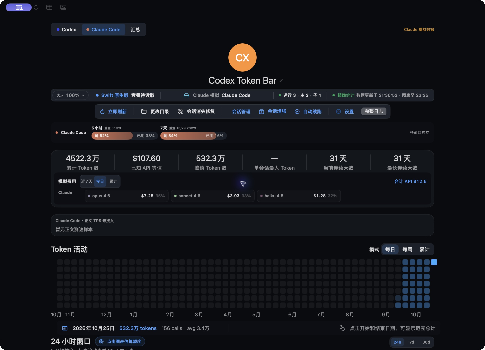
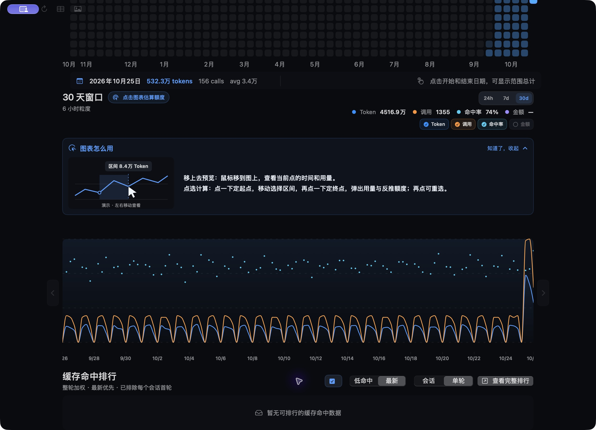
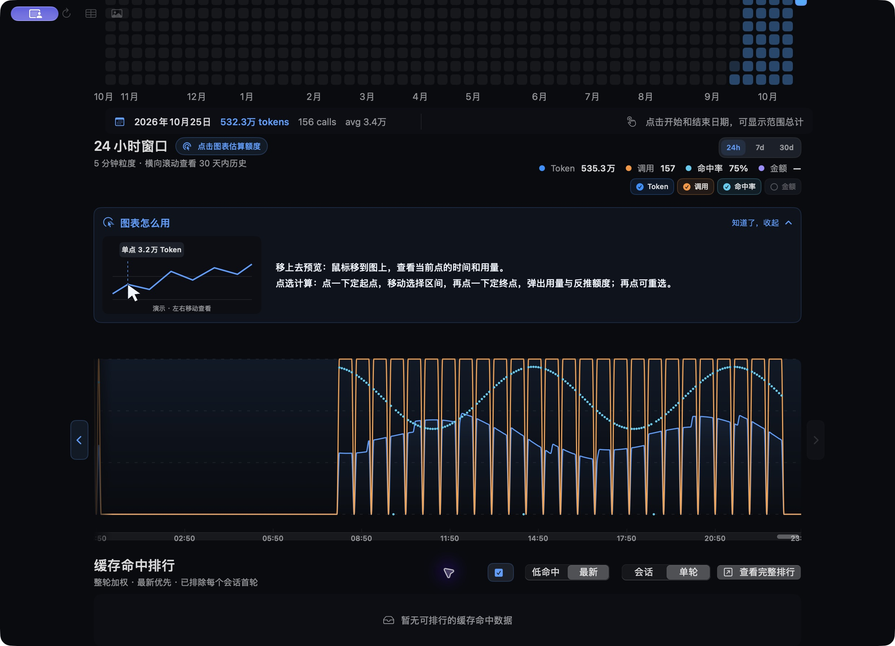
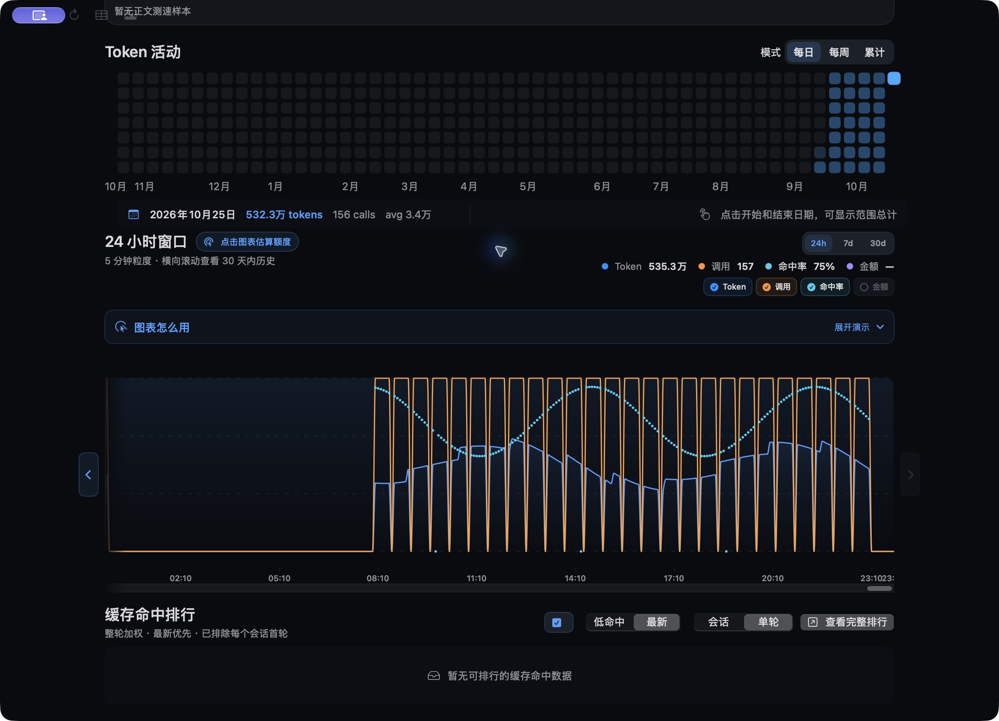

# 多客户端：改回原版组件及Claude模拟测试

2026-10-25 · 工作分支 `codex/multi-client-tokens` · 前一提交 `e51bb059`。

用户否决v7的并行表格与简化图表后，本次撤回其展示实现，保留已验证的解析、账本、价格和额度提供者。

## 实际改法

- 原生主页面所有范围都调用原`StatStrip`、`ActivitySection`、`RecentUsageChart`和`CacheHitRankingSection`；删掉`ScopedClientTokenSummary`/`ScopedClientUsageChart`等并行页面。原六项统计、模型费用卡片和交互图不替换样式。
- `ClientDashboardProjection`只将已入账用量投影为原组件的数据结构；Codex单看原样返回既有快照，其他客户端/汇总不写回Codex原账本。
- 原`DashboardModelCostRow`新增可选的预计算模型项，继续使用原模型卡片/标签。今日、近7天、累计由独立时间范围的后端汇总提供，不用累计数据冒充今日。非Codex不走Codex本期浏览器。
- 原`AccountQuotaStrip`内部复用`AccountQuotaSegment`显示多客户端窗口，不在主页面再追加一套横条。侧栏额度仍为单窗口整环、双窗口左右半环；三级用量/趋势接回原布局。
- 跨平台主页面也恢复`StatsStrip`、`DashboardAnalyticsSection`等原组件。多客户端额度呈现复用原QuotaBar，并在进入Codex归因持久化逻辑前分流，不能把合计用量写入Codex水位。
- 活动图输入补齐365天；原热力图的短历史尺寸保护使用全年53列参考尺寸。5分钟/小时图补齐零事件桶，不压缩空闲时间。未知缓存不当零命中，不将不完整字段画成可信0%。
- 暂无逐模型时间桶金额时保留原图Token/调用/已知缓存曲线，金额不可用；正文TPS仍明确未接入，不用模拟Token日志伪装测速。
- 聚合/定价沿用账本；新增今日/近7天缓存以revision和cutoff为键，8项上限。数据投影缓存按来源集合和两套数据修订失效，不跟随TPS每秒重算。

## Claude模拟数据及候选版边界

模拟数据只在 `scratch/launch-preview/home-v2` 下，正式Claude目录及正式TokenBar数据库未改写：

- `~/.claude/projects/tokenbar-simulated`：三种模型，1,357条带SIMULATED身份的请求，30天时间跨度。
- 模型：`claude-opus-4-6`、`claude-sonnet-4-6`、`claude-haiku-4-5`。
- `~/.claude-monitor/statusline/latest.json`：模拟5小时剩62%、7天剩84%，启动候选版时刷新测试时间。
- 候选App标识 `local.codex.token-bar.multiclient-preview`，使用独立CFFIXED_USER_HOME，界面显示「Claude 模拟数据」。此标记仅Debug专用Bundle ID且显式环境开关才有效。
- 网络外连由候选进程沙盒禁止；不访问Anthropic、不开启排行榜上报、不复制账号凭据。Codex视图使用此前24份本地日志副本及过滤后的元数据副本，不代表全历史。
- 正式 `/Applications/Codex Token Bar.app`未替换、未重启，Windows EXE未构建/替换。候选版仅从此worktree的Debug二进制启动。

可复查的本地启动收据：`scratch/launch-preview/process.json`、`simulated-data-receipt.json`，重开候选版脚本`restart-candidate.py`。

## 用户发现的热力图回归

短历史只有31个日期，原版按周数计算格子尺寸，约5列被拉到填满页面；固定180pt容器装不下，于是覆盖下面的折线图。此次同时补齐全年日期和添加短历史尺寸保护，并以原生App真实滚动截图核对。365天网格的总Token与原事实一致，补入的空日均为0。

## 验证

| 检查 | 结果 |
|---|---|
| Swift全量XCTest | PASS：1,950项，20项既有环境/可选测试跳过，0失败 |
| Agent Speed Swift Testing | PASS：647项，76套件 |
| Rust共享库全量串行 | PASS：1,398通过，11忽略，0失败 |
| UI全量 | PASS：1,257项，0失败 |
| TS / Vite | PASS |
| 原生图表/数据投影等定向回归 | PASS：142项，1项跳过，0失败 |
| `git diff --check` | PASS |
| 候选原生App实际运行 | 已启动；来源切换、Claude模拟额度、365天热力图、原30天图及最新24小时图均有实际渲染证据 |
| 正式安装 / Windows EXE / 多屏 / 功耗 | NOT_RUN；本次未替换正式版 |

全量日志：`scratch/original-components-swift-all-final.log`、`original-components-ui-all.log`、`original-components-rust-all.log`、`original-components-ts-final.log`。

首轮全量发现两处问题：图表的稳定跳转ID被来源ID替换（已恢复外层稳定锚点，内层按来源重建），以及原Header源码断言未包含新增来源过滤（已更新验证Codex仍沿用运行摘要、其他来源不冒用）。修正后上述全量结果零失败。

重点新增：原Codex快照透传、365天短历史、空闲时间桶、Token守恒、未知缓存、原六指标/原模型卡片DOM契约、多客户端额度不进入Codex归因持久化、今日/近7天定价缓存隔离。

实际界面截图（含模拟Claude数据）：

仍未做正式版安装、Windows真机、多屏和长时间功耗验收。Claude联网额度方案仍未实施。

## 原24小时图的滚动坐标同步

实际测试另发现：原AppKit偏移读取器可能报告0，而SwiftUI已用trailing anchor滚到末尾；按可视窗口裁剪的绘制路径仍留在最左侧，导致画面空白、标题却有历史用量。原30天图不横向滚动，因此不受影响。

此次保留原图及AppKit原生滚动条，仅用同一SwiftUI滚动容器的命名坐标空间读取实际偏移，统一窗口摘要、箭头状态和路径绘制范围。启动未落位的0偏移不覆盖默认最新窗口；用户后续回到最左侧仍可正确报告0。原生实测最新24小时窗口恢复绘制（535.3万模拟Token、157次模拟请求），并保留夜间0用量空档。

