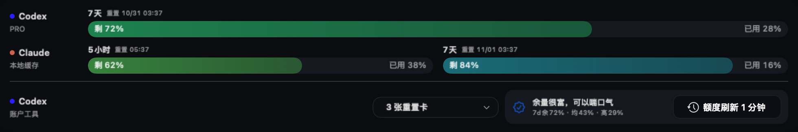
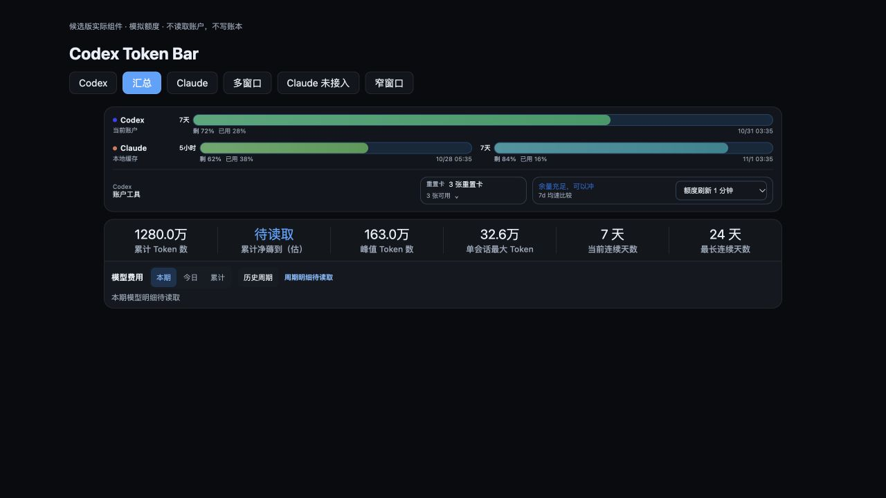
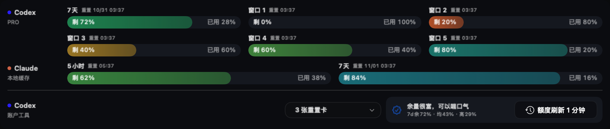
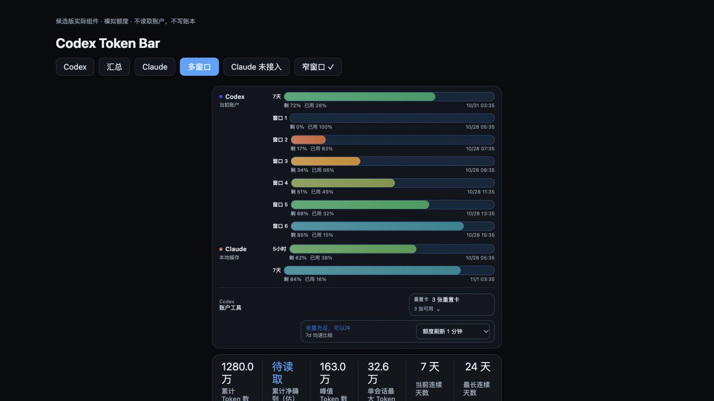

# 汇总主页额度布局修复与 main 合并

本批先在独立工作树 `codex/multi-client-tokens` 合入当时最新远端 main `89b716be`，合并提交 `c1232832`；main 的展示页、素材、文档改动均保留，无冲突。未操作主工作目录 `codex/cold-history-read-paths` 的分支或工作文件。

## 修复

之前汇总模式绕过完整 AccountQuotaStrip/QuotaStrip，使用简化的 clientRows/early return。因此重置卡、均速比较、刷新频率、额度读取提示/重试、诊断信息没有进入渲染树；网页把所有客户端窗口挤进一条横排，还继承侧栏的隐藏窗口选择。

现在复用原组件和原面板风格：

- 每客户端一行，品牌圆点和客户端名称定位；每个窗口保留剩余/已用百分比及重置时间。单窗口铺满，多个窗口换行，全部显示。
- Codex 账户工具集中在额度行下方，保留原重置卡按钮/详情、均速比较、刷新频率、读取诊断和重试。Luna Reserve 窗口仍独立，不把客户端额度百分比相加。
- Codex-only 仍走原布局。Claude-only 不挂载 Codex 归因 owner/工具，不显示别人账户的重置卡；未接入/不可用与已用尽 0% 明确分开。
- 网页主页使用完整额度 catalog，仅跟随客户端范围，不借用侧栏隐藏项。Codex 归因/均速比较另传原始 Codex dashboard，不能使用混合客户端后的 recentUsage24h、被清空的 attributionIdentity 或合成 freshness。
- 布局只在现有观察刷新时重新排版，无新增轮询、网络请求、动画定时器或数据库写入。

## 测试与渲染

- Swift 全量：2057 项应用 XCTest（20 条件跳过）、8 项 capture、649 项上游 Swift Testing，零失败。`scratch/aggregate-quota-swift-full.log`。
- 网页全量：1292/1292；TypeScript/Vite 构建通过。`scratch/aggregate-quota-ui-full-final.log`、`scratch/aggregate-quota-ui-build-final.log`。
- 专项：单窗口/Claude-only/8窗口原生实际渲染；汇总保留重置卡、刷新与警告；10窗口不丢；0% 与未接入区分；原始 Codex 比较输入契约。`scratch/aggregate-quota-native-final.log`、`scratch/aggregate-quota-ui-regression3.log`。
- 浏览器交互：汇总打开重置卡、展开单卡明细、关闭；多窗口在 520px 面板自动换行，工具不溢出；Claude-only 不显示 Codex 工具；Claude 未接入不伪造 0%。
- Rust/读取/迁移本批未改，前次 1481 Rust 测试、Windows 交叉编译和 C# 自测回执保留于 `2026-10-28-business-ledger-and-shared-io.md`，不冒充本批重跑。Windows 真实 EXE 视觉验收仍 NOT_RUN。
- 未安装、未重启、未替换正式应用；未迁移真实用户账本、未发布安装包。

以下全部为**候选组件实际渲染，额度为明确模拟数据**，不是正式应用截图，也不是真实账户额度证明。

开发预览入口：`tauri-app/dev-previews/dashboard-client-quota.html`。它只提供显示夹具，不读取账户或调用桌面命令。
